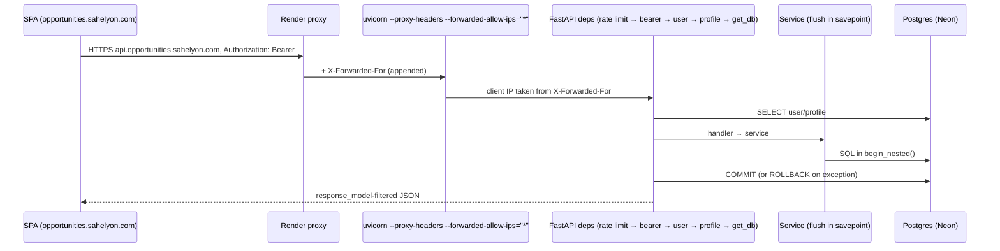
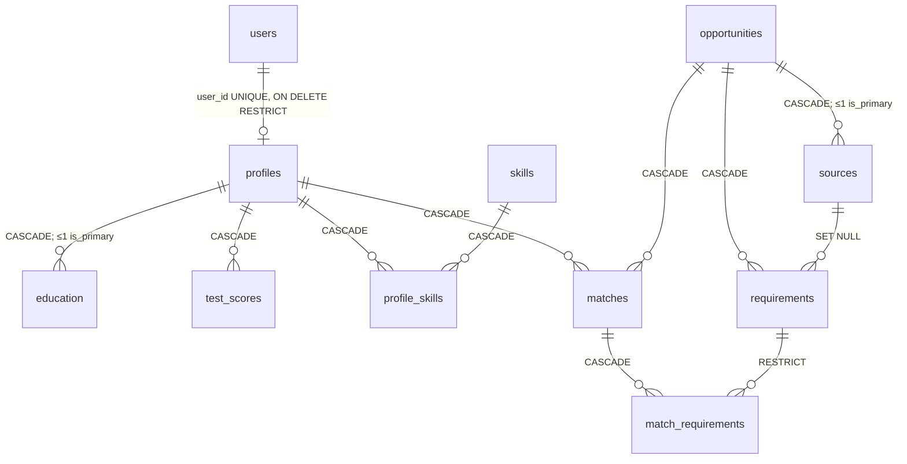
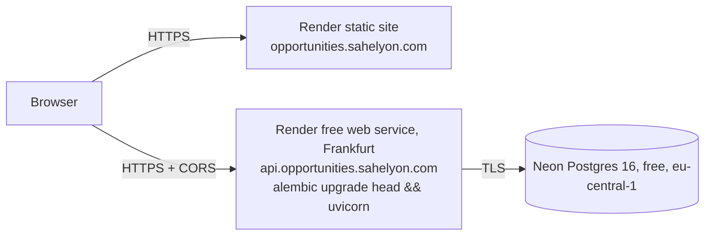
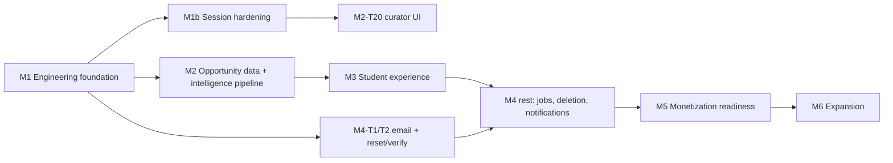
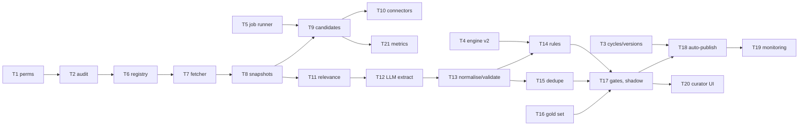
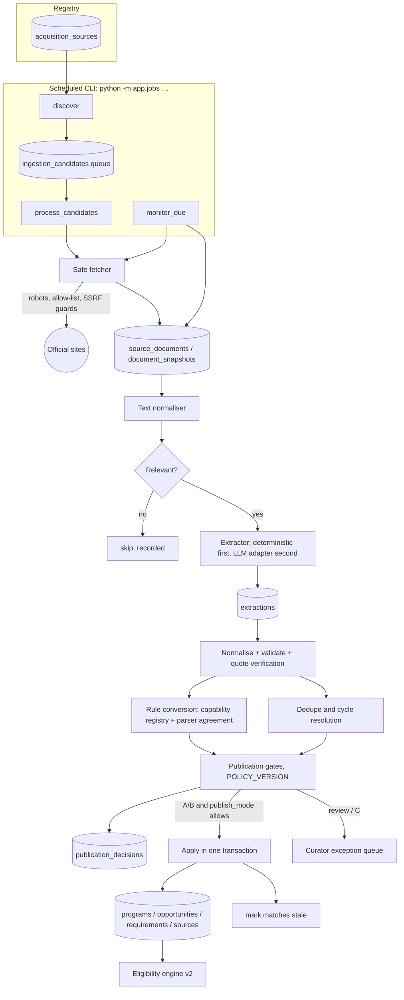
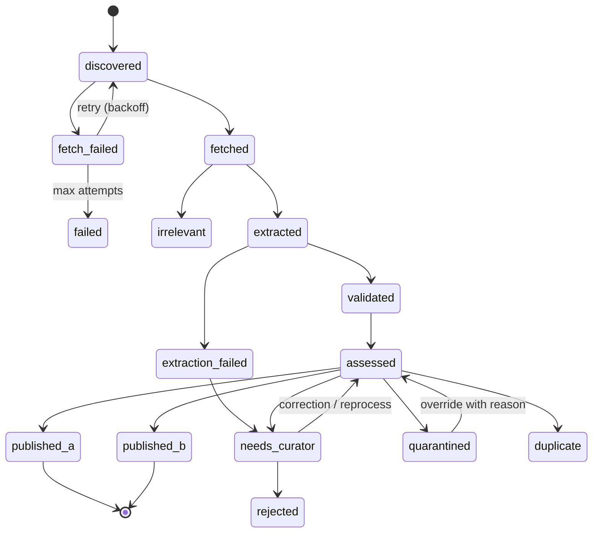

# Opportunity Hub 2.0 — Technical Architecture & Implementation Plan

| | |
| --- | --- |
| Status | Draft rev. 2 for founder review |
| Date | 2026-11-01 |
| Baseline | Branch `feat/opportunity-hub-product`, commit `b8da30f` |
| Companion | [`docs/product/OPPORTUNITY_HUB_2_PRD.md`](../product/OPPORTUNITY_HUB_2_PRD.md); requirement IDs (`AUTH-002`…) refer to it |
| Status note (2026-11-02) | §A describes the deployed baseline `b8da30f`. Work built since then is not deployed and not deployed; its state is recorded in the M1 status note (after the M1 table) and §F.8 |
| Rev. 3 changes | Automated opportunity intelligence pipeline (new §O): source registry, safe fetching, provider-independent extraction, quote-verified evidence, parser-agreement rule conversion, A/B/C publication policy with per-source rollout, programme/cycle model, monitoring. M2 rewritten as 21 small tasks; decisions DEC-22…28; risks R16…R22. |
| Rev. 2 changes | Custom-domain topology corrected (same-site, not cross-site). Session design changed from JWT + refresh to opaque server sessions in cookies. Verified engine capability table. Optional-rule semantics. Self-review permission model. Deletion retention model. Provider evaluations (email, hosting, jobs). Roadmap split into small tasks with IDs. Decision register (§L). |

**Conventions.** **[Existing]** = verified in source at the baseline. **[Proposed]** = not built.
**[Unverified]** = could not be confirmed from the repository. External prices were gathered from web
searches on 2026-11-01. They are third-party reports, not provider quotes, so re-check them before spending.
The test suite was **not run** while writing this document.

---

## A. Existing architecture

### A.1 Repository layout [Existing]
```
backend/  FastAPI app, Python ≥ 3.11 (Render pins 3.12.7)
  app/main.py              TrustedHost (only if ALLOWED_HOSTS), CORS (allow_credentials=False), routers, /health
  app/core/config.py       pydantic-settings; reads backend/.env; production JWT_SECRET strength check; '*' CORS rejected
  app/core/security.py     Argon2id; HS256 JWT, sub=user_id, 30-min TTL
  app/core/rate_limit.py   in-memory fixed window per (path, client IP); enabled by AUTH_RATE_LIMIT_PER_MINUTE
  app/api/deps.py          get_current_user, get_my_profile, get_owned_profile, require_admin_token (shared header)
  app/api/routers/         auth, profiles (+/me), education, test_scores, skills (+catalog), opportunities, matches
  app/services/            per-domain persistence; matching/ = engine (7 evaluators + registry + verdict)
  app/models/              SQLAlchemy 2.0; enums as String + CHECK constraints
  app/schemas/             Pydantic v2; per-kind requirement params registry (schemas/requirement.py)
  alembic/versions/        5 linear migrations
  scripts/seed_demo.py     973 lines: the curated dataset and the only writer of requirements and sources
  tests/                   21 modules, 501 test functions; dedicated Postgres test DB enforced by conftest.py
frontend/  React 19, TS 5.9, Vite 7, Tailwind 4, React Router 7, TanStack Query 5, openapi-fetch + generated
           schema.d.ts, Motion, Lucide; Vitest (src/lib/rules.test.ts) + Playwright (e2e/)
render.yaml   Blueprint: Python web service + static site; DB external (Neon)
scripts/dev-db.sh   isolated local Postgres cluster in .devdb/
```
There is no CI (`.github/` is absent), no Dockerfile and no worker.

### A.2 Request lifecycle and transactions [Existing]

The commit-per-request plus service-savepoint pattern (`db/session.py::get_db`, every service) works well.
Keep it.

### A.3 Authentication [Existing]
Register → login → JWT stored as `{token, email, expiresAt}` under `localStorage["oh.session"]`. A client
timer and any 401 send the user to `/login?expired=1`. There is no refresh, revocation, reset or
verification. Curator writes require `X-Admin-Token == ADMIN_API_TOKEN` (constant-time), and they are
disabled when it is unset, which is the production setting per `docs/DEPLOYMENT.md`.

### A.4 Database [Existing]

Constraints that drive the plan:
- `match_requirements.requirement_id ON DELETE RESTRICT`: an evaluated requirement can't be deleted, so
  rule edits must retire rows instead.
- `profiles.user_id ON DELETE RESTRICT`: deleting a user fails while their profile exists.
- `uq(matches.profile_id, opportunity_id)`: one current match per pair.
- `profiles.email` is unique and duplicates `users.email`.

### A.5 Eligibility flow [Existing]
`POST /me/opportunities/{id}/match` → load profile (education, skills) and opportunity (requirements) →
`evaluate_requirements` (ordered by `order_index`) → registry dispatch by `kind` (unknown kind or `unparsed`
→ `needs_review`) → verdict → `persist_match_evaluation` upserts the Match, replaces its evidence rows and
stamps `engine_version="1"`. The frontend (`features/eligibility.tsx`) does this once per published
opportunity, 4 at a time. Staleness exists only in React state.

### A.6 Frontend [Existing]
`app/App.tsx` sets up the providers, lazy routes and the `RequireAuth`/`RequireProfile` guards. Routes: `/`,
`/opportunities[/:id]` (public), `/login`, `/register`, `/onboarding`, `/discover`, `/eligibility`,
`/profile`, `/credits`, `/privacy`. `api/client.ts` holds the typed client, auth middleware and
`ApiError`. `api/queries.ts` holds every query hook. `lib/rules.ts` is a **hand-maintained copy** of the
engine's metric knowledge and already diverges from the engine (§E.1). `components/eligibility/Evidence.tsx`
shows "Not evaluated" as the actual value for `needs_review` rows.

### A.7 Deployment [Existing config; live state Unverified]

- **Domains:** `docs/presentation/README.md` names the custom domains as live. `render.yaml` still names
  `*.onrender.com` in `CORS_ORIGINS` and `VITE_API_BASE`, which is **configuration drift** (R4, M1-T7).
- **Deploy branch:** Render deploys from `feat/opportunity-hub-product`, not from `main`.
- **Cold start:** the free web service sleeps after 15 minutes idle, with roughly a 1-minute cold start
  (`docs/DEPLOYMENT.md`).

---

## B. Proposed architecture

### B.1 Modular monolith [Proposed; DEC-01]
One FastAPI process, one Postgres database, one static frontend, plus a **scheduled CLI** running the same
codebase (§D). Rationale: one developer, a small budget, low expected load, and existing router → service
→ model seams. No microservices, message broker, Redis or search engine.

### B.2 Module boundaries
Reorganise into packages **only when a milestone touches a domain**. There is no up-front restructuring.

| Module | Tables | Exposes | Calls |
| --- | --- | --- | --- |
| identity | users, sessions, email_tokens, rate_limit_buckets | `/auth/*`, `/me`, `get_current_user`, `require_permission` | notifications.send_email |
| profiles | profiles, education, test_scores, profile_skills, skills | `/me/profile*`, `/skills`; bumps `facts_version` | eligibility.mark_stale |
| opportunities | opportunities, sources, requirements, publications, verifications | public reads, `/curate/*` | eligibility.mark_stale, audit.record |
| eligibility | matches, match_requirements | evaluate, batch, staleness, `/eligibility/capabilities` | read-only use of profiles/opportunities |
| tracking | saved_opportunities, applications, application_items | `/me/saved*`, `/me/applications*` | opportunities (read) |
| notifications | notifications, email_outbox | `/me/notifications*`, `send_email()` behind `EmailSender` | — |
| intelligence (new) | acquisition_sources, source_documents, document_snapshots, ingestion_candidates, extractions, publication_decisions | `/curate/sources`, `/curate/candidates`, jobs `discover`, `process_candidates`, `monitor_due` | opportunities.publish (service), eligibility.mark_stale, audit.record |
| audit/admin | audit_log, deletion_tombstones, job_runs | `/admin/*`, CLI | services only |

Rule: a router calls only its own module's services. Cross-module access goes through service functions,
never through another module's ORM queries.

### B.3 One source of truth for rule capabilities [Proposed]
`services/matching/capabilities.py` lists each supported `(kind, metric, operators, arity)` and the profile
fact it reads. It is used by write-time validation (ELIG-002), by `GET /eligibility/capabilities`, by the
frontend "Read by rules" labels (PROFILE-002), by the curator editor dropdowns and by the privacy page copy.
`frontend/src/lib/rules.ts` keeps only the human wording.

---

## C. Database evolution

**Conventions (existing):** UUID PKs, `timestamptz`, enums as String + CHECK, partial unique indexes for
"at most one" rules, request-scoped transactions.
**Migration rules:**
- Additive first.
- Destructive steps only one release after the code stops reading the old shape.
- Every migration has a downgrade.
- Backfills are single statements, because migrations run in the web start command.

### C.1 Changes to existing tables
| Table | Change | For |
| --- | --- | --- |
| users | `role` (`student`/`curator`/`admin`, default `student`), `email_verified_at`, `deletion_requested_at`, `deletion_due_at` | AUTH-007, AUTH-003, AUTH-005 |
| profiles | FK `user_id` → **CASCADE** (with M4-T4); `facts_version int default 1` | AUTH-005, ELIG-007 |
| profiles.email | per DEC-10: stop writing → drop/rename one release later | PROFILE-006 |
| opportunities | extend status CHECK with `in_review`, `withdrawn`; `ruleset_version int default 1`; `created_by` (FK users SET NULL); `last_verified_at`; `discovery_method` | OPPTY-003/004/005 |
| requirements | `ruleset_version int not null default 1`; `retired_at timestamptz null`; index `(opportunity_id, retired_at, order_index)` | OPPTY-005 |
| matches | `ruleset_version`, `facts_version` (default 1) | ELIG-005 |

Backfill: every version = 1, and `last_verified_at` = the primary source's `retrieved_at`. Existing matches
are then current, which is correct because they were computed against v1 inputs. The engine v2 bump (M2-T4)
then marks them stale on purpose.

### C.2 New tables
| Table | Key fields | Constraints / indexes | Privacy |
| --- | --- | --- | --- |
| `sessions` | `id`, `user_id` FK CASCADE, `token_hash char(64)`, `created_at`, `last_seen_at`, `expires_at` (absolute), `revoked_at`, `user_agent` (truncated) | unique `token_hash`; `(user_id)` | raw token never stored; purge 30 days after expiry |
| `email_tokens` | `user_id` FK CASCADE, `purpose` (`verify`/`reset`/`cancel_deletion`), `token_hash`, `expires_at`, `used_at` | unique `token_hash` | hashed |
| `rate_limit_buckets` [built, not deployed: `7a929229fe00`] | `scope text` (endpoint path), `key char(64)` (HMAC-SHA256 of `client:<address bucket>` or `account:<normalised email>`, key derived from `JWT_SECRET`), `window_start timestamptz`, `count int` | PK `(scope, key, window_start)`; CHECK `count >= 1`, CHECK `char_length(key) = 64`; index on `window_start` | neither addresses nor emails are stored, only keyed digests; no hourly purge: roughly one write in 200 deletes windows older than the previous one, so rows live about two minutes |
| `publications` (superseded by `publication_decisions`, §O.8) | `opportunity_id`, `ruleset_version`, `created_by`, `reviewed_by`, `published_by`, `published_at`, `self_reviewed bool`, `verification_id` | unique `(opportunity_id, ruleset_version)` | user FKs SET NULL |
| `opportunity_verifications` | `opportunity_id`, `verified_by`, `verified_at`, `method`, `source_hashes jsonb`, `note` | `(opportunity_id, verified_at desc)` | — |
| `saved_opportunities` | `profile_id` CASCADE, `opportunity_id` CASCADE, `confirmations jsonb`, `reminders_enabled` | unique `(profile_id, opportunity_id)` | user data |
| `applications` | `profile_id` CASCADE, `opportunity_id` RESTRICT, `status`, `outcome`, `notes`, `target_date`, `submitted_at`, `outcome_at` | unique `(profile_id, opportunity_id)` (DEC-14); CHECK outcome only with submitted | **sensitive**: excluded from admin UI and analytics |
| `application_items` | `application_id` CASCADE, `requirement_id` SET NULL, `label`, `status`, `due_date`, `note`, `order_index` | `(application_id, order_index)` | user data |
| `notifications` | `user_id` CASCADE, `kind`, `payload jsonb`, `dedupe_key`, `read_at` | unique `(user_id, dedupe_key)` | 90-day retention |
| `email_outbox` | `user_id` CASCADE null, `to_address`, `template`, `params`, `status`, `attempts`, `last_error`, `send_after`, `sent_at`, `dedupe_key` | unique `dedupe_key`; `(status, send_after)` | purge 30 days after send |
| `audit_log` | `bigserial id`, `actor_user_id` (**no FK**), `action`, `target_type`, `target_id`, `diff jsonb`, `created_at` | `(target_type, target_id, created_at)` | never tokens, passwords or profile contents; 12-month retention (proposed, DEC-09) |
| `deletion_tombstones` | `user_id`, `purged_at` | PK `user_id` | id only, no PII; used to re-apply deletions after a backup restore |
| `job_runs` | `job`, `started_at`, `finished_at`, `status`, `detail` | `(job, started_at desc)` | — |

User notification preferences are stored as **columns on `users`** (two or three booleans), not a table.
**Not added (overengineering for now):** match history, source snapshot table (use the existing
`sources.raw_snapshot`), subscriptions/billing tables (M5b only), document storage, analytics events (use
SQL views first).

### C.3 Why retirement and not a version table (DEC-11)
Retiring rows and stamping `ruleset_version` keeps every `match_requirements.requirement_id` valid. The
existing RESTRICT FK then becomes a safeguard instead of a blocker. This costs two columns and changes
nothing in the evidence schema.

### C.4 Migration sequence
| Migration | Milestone | Content |
| --- | --- | --- |
| MIG-1 | M1-T3/T4 | `users.role`; `rate_limit_buckets` |
| MIG-2 | M1b-T1 | `sessions` |
| MIG-3 | M2-T2/T3 | `audit_log`, workflow statuses, versions, `retired_at`, `publications`, `opportunity_verifications`, `created_by`, `facts_version`, match version columns, `job_runs` |
| MIG-4 | M3-T4 | education field-of-study key (taxonomy) |
| MIG-5 | M3-T5/T6 | `saved_opportunities`, `applications`, `application_items` |
| MIG-6 | M4-T1/T2 | `email_outbox`, `email_tokens`, `users.email_verified_at`, preference columns |
| MIG-7 | M4-T4 | `users.deletion_*`, `deletion_tombstones`, `profiles.user_id` → CASCADE |
| MIG-8 | M4-T5 | `notifications` |
| MIG-P1 | M2-T6/T8 | `acquisition_sources`, `source_documents`, `document_snapshots`; `sources.snapshot_id` |
| MIG-P2 | M2-T9/T12 | `ingestion_candidates`, `extractions` |
| MIG-P3 | M2-T17 | `publication_decisions` (supersedes the planned `publications` table) |
| MIG-9 | ≥ 1 release after M3-T4 | drop or rename `profiles.email` |

Every migration must be compatible with the previously deployed code, because Render starts the new
instance while the old one is still serving.

### C.5 Account deletion and retention model [Proposed; DEC-08, DEC-09]

**Flow.**
1. `DELETE /me` with the password.
2. Set `is_active=false`, set `deletion_requested_at` and `deletion_due_at = now + window`, and revoke every
   session.
3. Cancel pending non-essential outbox mail.
4. Send a confirmation email containing a cancel link valid until `deletion_due_at`.
5. A daily job purges the account when it is due.

Login is refused during the window with the generic 401. Recovery is **only** through the cancel link,
which reactivates the account and requires a new sign-in.

| Data | At request | At purge (window end; proposed 14 days) | Backups |
| --- | --- | --- | --- |
| users row | disabled | deleted; `deletion_tombstones` row written | until rotation |
| sessions, email tokens | deleted/revoked | — | until rotation |
| profile, education, test scores, profile_skills, matches + evidence | retained, inaccessible | deleted (CASCADE after MIG-7) | until rotation |
| saved opportunities, applications, items, notes, notifications | retained, inaccessible | deleted (CASCADE) | until rotation |
| email_outbox | pending sends cancelled except the deletion email | deleted | until rotation |
| audit_log | deletion request logged | retained 12 months (proposed), referencing only the opaque user id | until rotation |
| Curator-authored opportunities, verifications, publications | unchanged | kept (platform content); user FKs set NULL, displayed as "former curator" | — |
| Host logs | — | expire on the provider's schedule (**Unverified**); must contain no PII by design | — |
| Email provider logs | — | expire on the provider's retention (reported as 30 days on Resend's free plan; **Unverified**) | — |

**Backups.** A rolling retention is proposed (35 days, DEC-21). Deleted data stays in backups until they age
out, and `/privacy` must say so. Every restore procedure re-applies `deletion_tombstones` (deleting those
user ids) before the restored database serves traffic. A test covers this.

**Legal.** Ethiopia's personal data protection legislation, and the GDPR for EU-resident users, may impose
duties or retention limits. This document makes **no compliance claim**. The window, the audit retention
and the backup retention need review (DEC-09).

---

## D. Background processing

| Job | Schedule | Milestone | Idempotency |
| --- | --- | --- | --- |
| `close_expired` (OPPTY-006) | daily | M2-T5 | conditional `UPDATE … WHERE status='published' AND deadline_at < now()` |
| `freshness_flags` (OPPTY-007) | daily | M2-T5 | derived state, recomputed |
| `send_outbox` (NOTIF-001) | every 5 min (cron limits Unverified) | M4-T3 | row status + `dedupe_key` |
| `deadline_reminders` (NOTIF-002) | daily 06:00 EAT | M4-T3 | `notifications`/`outbox` dedupe keys |
| `purge_deleted_accounts` (AUTH-005) | daily | M4-T4 | due-date filter + tombstone |
| `housekeeping` | daily | M2-T5 | delete expired sessions/tokens/buckets/notifications |
| `discover`, `process_candidates`, `monitor_due` | per source policy / every run window | M2-T9, T19 | unique keys + `SKIP LOCKED` leases (§O.4) |
| `weekly_digest` | weekly | post-MVP | dedupe key per week |

Mechanism: `python -m app.jobs <name>`. Each job takes a Postgres advisory lock, writes a `job_runs` row and
is safe to run twice. Re-evaluation after a profile edit runs **synchronously** (batch endpoint). After a
publish it runs **lazily** (stale until read). No in-process scheduler (APScheduler) and no queue.

---

## E. Eligibility engine review

### E.1 Verified capability table
Validator = `backend/app/schemas/requirement.py`. Evaluator = `backend/app/services/matching/<kind>.py`.

| Kind | Validator accepts | Engine evaluates | Accepted but not evaluated (→ `needs_review`) | Recommendation |
| --- | --- | --- | --- | --- |
| `numeric_threshold` | any `metric`; `>= <= > < == !=`; `value` float; `scale` optional > 0 | `metric=gpa`, `>=` only; primary education; requires `scale` and an **equal** profile `gpa_scale`; no GPA → `unknown` | any other metric; any other operator; missing `scale` (`gpa_threshold_scale_unspecified`) | **Reject** other metrics and operators; **require** `scale` for GPA |
| `set_membership` | any `metric`; `in`, `not_in`, `within_taxonomy`; `allowed` ≥ 1 item | `metric=citizenship`, `in`/`not_in`, **exactly one** allowed value | multi-value lists (`invalid_set_membership`); `within_taxonomy`; other metrics. **Also:** an empty profile list yields `not_met` (tested, deliberate) | **Implement** multi-value `in` (holds any) and `not_in` (holds none), because the semantics are well defined and calls often list several countries; **reject** `within_taxonomy` until PROFILE-004; empty citizenship → `unknown` (DEC-05) |
| `equality` | any `metric`; `==`, `!=`; scalar value | `metric=degree_level`, `==` only | `!=`; other metrics | **Reject** `!=` (use `any_of` of allowed levels); the frontend already renders "Degree level is not …" text for this unevaluated shape |
| `boolean_flag` | any `metric`; `expected` bool | `metric=is_currently_enrolled` | other metrics | **Reject** other metrics |
| `date_gate` | any `metric`; all six operators; date value | `metric=date_of_birth`, all six | other metrics | **Reject** other metrics |
| `skill_set` | `metric` (default `skills`); `contains_any`/`contains_all`; `required` ≥ 1 | canonical skill keys; empty profile → `not_met` | other metrics; required keys that are **not in the catalog** silently never match | **Reject** unknown skill keys at write time |
| `any_of` | children = `kind`+`params` only (`extra="forbid"`); nesting unbounded in validation | OR: `met` > `unknown` > `needs_review` > `not_met`; depth > 5 → `needs_review` | evaluator reads a child `is_ambiguous` the schema can never contain (dead code) | Apply capability validation **recursively**; cap depth at 2 in validation (proposed); keep ambiguity on the group only; delete the dead read in the v2 change |
| `unparsed` | `reason` required, extra allowed | not dispatched → `needs_review` with reason code `unsupported_requirement_kind` | — (by design) | Keep; give it its own reason code `unparsed_requirement` so the UI can say "Not machine-checkable" rather than "unsupported" |

`is_ambiguous=true` on any top-level requirement → `needs_review` (`ambiguous_requirement`) [Existing].

### E.2 Unsupported operators: decision (DEC-06)
**Default: reject at validation (option 2).** Implement (option 1) only shapes with clear semantics and
demonstrated need. Multi-value citizenship qualifies today. Consequences:
- Curators can no longer author rules that silently produce `needs_review`. A condition the engine can't
  check must be entered as `unparsed` with its quote, which is honest.
- Rows already stored remain readable and keep producing `needs_review`. The seed data must still validate
  under the stricter rules; a test runs every seed requirement through `RequirementCreate`.
- `GET /eligibility/capabilities` lets the UI and curator editor offer only valid shapes.

### E.3 UI honesty for unevaluated rules (ELIG-003)
- The rule statement (from `lib/rules.ts::describeRule`) describes the rule, not a result. A
  `needs_review` row must always carry the label "Not checked automatically" plus the reason, and must never
  use the met/not-met marks.
- A Vitest test enumerates every reason code from the backend and asserts each has copy.
- A Playwright test asserts that a `needs_review` row never shows a "met" mark.

### E.4 Mandatory vs optional (ELIG-004, DEC-04)
New verdict function (engine v2):
```
mandatory = results where requirement.is_mandatory
1. any mandatory not_met       → not_eligible
2. any mandatory needs_review  → needs_review
3. any mandatory unknown       → potential_match
4. otherwise                   → eligible
optional results: reported, never change the verdict (met / not_met / unknown / needs_review)
```
`facts` JSON gains a per-group breakdown: `{"mandatory": {...counts}, "optional": {...counts}}`. Top-level
counts are kept for API compatibility. `MatchRequirementRead.requirement.is_mandatory` already exists, so the
UI can group rows without a schema change.

**Test matrix:** every combination of {mandatory, optional} × {met, not_met, unknown, needs_review} for one-
and two-rule opportunities, plus "all optional".

**Compatibility:** confirm read-only on production that no requirement has `is_mandatory=false` (M2-T4 step
1). The seed sets none, and no API can create requirements. Then bump `ENGINE_VERSION` to `"2"`.

### E.5 Other review points
- **`unknown` vs `needs_review` precedence:** keep `needs_review` above `unknown`. Adding a fact can't
  resolve a review item.
- **GPA:** keep strict same-scale comparison and no conversion. Profiles store the scale as entered. A
  threshold without a scale will be rejected at write time (E.1).
- **Reproducibility:** `engine_version` + `ruleset_version` + `facts_version` on each match (C.1). A
  golden-file test fixes the outputs (outcome, reason code, expected, actual) for a corpus of profiles ×
  rules. Any diff fails unless `ENGINE_VERSION` changed in the same commit.
- **Re-evaluation:** see PRD §F.8. Staleness is computed as `match.engine_version != ENGINE_VERSION OR
  match.ruleset_version != opportunity.ruleset_version OR match.facts_version != profile.facts_version`.
  `facts_version` is incremented in the service layer when, and only when, a capability-registered fact
  changes (citizenships, DOB, degree level, enrolment, primary education GPA/scale/field, skills).
- **Rollback of engine v2:** reverting the code sets `ENGINE_VERSION` back to "1". v2 matches then become
  stale and are re-evaluated lazily. No data repair is needed.

---

## F. Authentication and session architecture

### F.1 Topology facts
- Frontend `https://opportunities.sahelyon.com` and API `https://api.opportunities.sahelyon.com` are
  **different origins but the same site**: both sit under the registrable domain `sahelyon.com`. So:
  - CORS is still required. Cookies need `allow_credentials=True` and an exact origin.
  - `SameSite=Lax/Strict` cookies **are** sent on `fetch` calls from the frontend to the API.
  - **Every other `*.sahelyon.com` host is also same-site.** SameSite gives no CSRF protection against a
    compromised or attacker-controlled sibling subdomain. Whether the founder runs other services under
    `sahelyon.com` is **Unverified** (DEC-02).
- Rev. 1 assumed `onrender.com` hosts, which are cross-site because `onrender.com` is on the Public Suffix
  List. That assumption is withdrawn.

### F.2 Options compared
| Concern | A. Bearer JWT in localStorage (today) | B. Opaque server session in HttpOnly cookie | C. Short access JWT + refresh cookie |
| --- | --- | --- | --- |
| XSS | script can **read and exfiltrate** the token | token unreadable; XSS can still act *while the page is open* | access token in memory, still usable by XSS; refresh unreadable |
| CSRF | none (header not auto-sent) | must be defended (F.4) | must be defended on refresh/logout |
| Revocation / logout | impossible before expiry | delete the row; immediate | refresh revocable; access valid ≤ TTL |
| Expiry UX | hard 30 min | idle + absolute expiry, sliding | silent refresh |
| Server cost | none | one indexed lookup per request (a user lookup already happens today) | lookup only on refresh |
| Complexity | low | low–medium | **highest** (rotation, reuse detection, two token types) |

**Recommendation: B (DEC-03).** It removes token theft, gives real logout and revocation (needed by
AUTH-002/005/009), and is simpler than C. C's advantage (no DB lookup per request) doesn't matter here,
since every request already loads the user. Cookies are **not automatically secure**. The protections below
are mandatory.

### F.3 Cookie and session specification
- Cookie: `__Host-oh_session=<32 random bytes, base64url>`.
- Attributes: `Secure; HttpOnly; SameSite=Lax; Path=/`, with **no `Domain` attribute**. The cookie is then
  host-only on `api.opportunities.sahelyon.com`, and the `__Host-` prefix makes the browser enforce that.
  **Never** set `Domain=.sahelyon.com`.
- `SameSite=Lax` rather than `Strict`: both work for these same-site requests, and Lax avoids edge cases on
  cross-site navigation. Neither protects against sibling subdomains (F.1), so the CSRF controls below are
  required either way.
- Storage: SHA-256 of the token in `sessions`.
- Lifetime: idle timeout 7 days, absolute 30 days (proposed, DEC-03). `last_seen_at` is updated at most once
  every 5 minutes.
- Sensitive actions (password change, account deletion, future email change) require the current password.
- Logout deletes the session and expires the cookie. "Sign out everywhere" revokes all of the user's
  sessions. Password reset, deletion and deactivation also revoke all sessions.
- Login rotates the session (no fixation), and the old row is deleted.

### F.4 CSRF and CORS
- CORS: `allow_origins=["https://opportunities.sahelyon.com"]` (plus the dev origin only in development),
  `allow_credentials=True`, methods as today, headers `Content-Type` + `X-OH-Client`.
- For unsafe methods (POST/PUT/PATCH/DELETE), middleware requires:
  1. an `Origin` header exactly in the allow-list (reject if missing), and
  2. `X-OH-Client: web`.

  A custom header forces a CORS preflight, which only allowed origins pass. Together these block both
  cross-site and sibling-subdomain form posts.
- A synchronizer CSRF token is unnecessary given these controls. Reconsider it if non-browser clients appear.
- Public GET endpoints never change state (Existing; keep it that way).

### F.5 Development vs production
- Development: Vite already proxies `/api` to the same origin (`vite.config.ts`).
- Chrome and Firefox accept `Secure` and `__Host-` cookies on `http://localhost`. Safari behaviour is
  **Unverified**.
- Settings: `SESSION_COOKIE_NAME` (dev default `oh_session_dev`, without the prefix), `SESSION_COOKIE_SECURE`,
  `CSRF_TRUSTED_ORIGINS`.
- The start-up validator refuses production if the cookie isn't Secure or `__Host-`, or if the origin list
  is empty (same pattern as `require_strong_production_secret`).

### F.6 Roles and permissions
Permissions live in code (`ROLE_PERMISSIONS` dict), with no permission tables:

| Permission | student | curator | admin |
| --- | --- | --- | --- |
| `opportunity.create/edit/verify/submit` | — | ✓ | ✓ |
| `opportunity.review`, `opportunity.publish` | — | ✓ | ✓ |
| `user.manage`, `audit.read`, `jobs.read` | — | — | ✓ |

- **Self-review (DEC-07):** a publish where the reviewer is also the draft's creator or last editor is
  allowed and stored with `self_reviewed=true`.
- **Separation of duties:** the setting `REQUIRE_INDEPENDENT_REVIEW=false` becomes `true` when the team
  grows. Publish then returns 403 for self-review. A test covers both settings.
- **Student-facing wording:** "Reviewed by the Opportunity Hub team on <date>", never "independently
  verified".
- **Bootstrap:** the first admin comes from the CLI `python -m app.cli grant-role <email> admin`, run as a
  one-off job. The `X-Admin-Token` path is removed in M2-T1.

### F.7 Other security items
| ID | Item | Status | Action |
| --- | --- | --- | --- |
| S1 | Token in localStorage, no CSP | Confirmed | M1b; CSP in report-only first (M1-T7), then enforced. The inline theme script in `index.html` needs a hash |
| S2 | `--forwarded-allow-ips="*"`: uvicorn 0.54 (local venv) takes the client-supplied leftmost `X-Forwarded-For` entry. Render reportedly **appends** to client-sent headers (community reports; one Render staff answer says the first entry is the real client). Bypass of the auth limiter is **plausible but unverified** in production; **reproduced locally** with the same flags (rotating forged entries never hit the address limit). The app-side trust policy (built, not deployed) can't fix it while uvicorn rewrites the peer | Open; production exposed | M1-T2 (Render support request, `RENDER_CLIENT_IP_VERIFICATION.md`), then the start-command change |
| S3 | In-memory limiter resets on every restart/sleep | Confirmed in production; fixed in code that isn't deployed yet (PostgreSQL counters) | M1-T3 deploy |
| S4 | No password reset | Confirmed | M4-T2 (may start in parallel with M2) |
| S5 | No revocation | Confirmed | M1b |
| S6 | Shared admin token | Confirmed (disabled in prod) | M1-T4 / M2-T1 |
| S7 | Registration discloses existing email | Accepted trade-off | keep; rate-limited |
| S8 | Deletion impossible (FK RESTRICT) | Confirmed | M4-T4 |
| S9 | `ALLOWED_HOSTS` unset | Confirmed | M1-T7: set to `api.opportunities.sahelyon.com` once the Render health-check Host is verified |
| S10 | `profiles.email` duplicate PII | Confirmed | M3-T4 |
| S11 | No dependency audit / CI | Confirmed | M1-T1 |
| S12 | Production seed run from a laptop shell (`docs/DEPLOYMENT.md` §2.5) | Process | M2-T16 turns it into a one-off job |
| S13 | `GET /profiles/{id}`: second, unused read path | Confirmed (unused by frontend) | remove in M1b-T3 |
| S14 | `dangerouslySetInnerHTML` or raw HTML rendering | **Unverified** | M1-T7 grep + lint rule |

### F.8 Credential-limit telemetry and the address threshold [built in part, not deployed]
**Built** (`app/core/auth_telemetry.py`): five events with labels from closed sets only (endpoint, strategy,
reason, budget; anything else becomes `other`). It never records addresses, emails, digests or account ids.

| Event | Labels |
| --- | --- |
| `ip_budget_exhausted` | endpoint |
| `account_budget_exhausted` | endpoint |
| `client_identity_degraded` (WARNING) | endpoint, strategy, reason |
| `auth_failure` | endpoint |
| `success_after_throttle` | endpoint, budget |

**Limits:**
- Counters live in the process and reset on restart or sleep.
- Several instances do not aggregate.
- There is no exporter or monitoring backend.
- Each event and label set logs at most once a minute with an occurrence count, so occurrences at the end
  of a burst appear only when a later matching event arrives after the interval.
- `success_after_throttle` only looks at the previous window.
- `rate_limit_buckets` can't answer threshold questions:
  - address and account rows share `scope` and have opaque keys, so they can't be told apart;
  - rows live about two minutes.
- Under the current production start command, address buckets are chosen by the caller, so address
  telemetry from production means nothing until R1 is closed.

**Before changing the 10-per-minute address limit** (it stays unchanged until then):
1. R1 closed: the production client identity is trustworthy.
2. At least two to four weeks of data, including a term-start or deadline peak.
3. Per endpoint and window, a histogram of attempts per address bucket and per account (p50, p95, p99,
   max), with the budget kind recorded separately. Proposed: before pruning, roll each finished window up
   into an aggregate table `(window_start, endpoint, budget, count_band, keys)` that stores no keys
   (new migration, needs approval).
4. The ratio of `success_after_throttle{budget=ip}` to `ip_budget_exhausted` (likely false positives,
   such as shared campus or carrier NAT), and its trend.
5. Optionally, distinct accounts per address bucket per window (a NAT-size signal) as a banded count
   only. It links an address digest to account digests for one window, so it needs a privacy decision first.
6. The rate of `client_identity_degraded` by reason after any proxy change (it should be near zero).

---

## G. Infrastructure choices

### G.1 Transactional email (DEC-13)
| Criterion | **Resend** | **Amazon SES** | Postmark | SendGrid |
| --- | --- | --- | --- | --- |
| Free allowance (reported) | 3 000/month, **100/day**, 1 domain | ~3 000/month for 12 months (reports vary); sandbox until approved | 100/month, no expiry | reportedly ended its free tier |
| Paid entry (reported) | $20/month for 50 000 | $0.10 per 1 000 | $15/month for 10 000 | — |
| SPF/DKIM/DMARC | DNS records on our domain; DMARC is ours to publish | DKIM (Easy DKIM), custom MAIL FROM; DMARC ours | DKIM + Return-Path; DMARC ours | — |
| Python integration | HTTP API, official SDK; SMTP too | `boto3`; SMTP | HTTP API, SMTP | — |
| Ops complexity | low | **higher**: production-access review, bounce/complaint handling via SNS, IAM | low; account approval | — |
| Account eligibility | sign-up reportedly needs no card for free; paid tiers need an international card. Restrictions for an Ethiopia-based founder **Unverified** | AWS account requires a card; approval is manual | manual approval | — |
| Reputation | newer service; shared IPs | mature; shared IPs, reputation tied to your sending | strongest transactional reputation in community reports | — |

- **Recipients in Ethiopia:** no provider publishes country-specific deliverability. Delivery depends mostly
  on the recipient's mailbox provider: Gmail and Outlook for most students, plus university domains such
  as `*.edu.et`, whose filtering is **Unverified**.
- **Pre-launch seed test:** send to Gmail, Outlook, Yahoo and at least 2 Ethiopian university mailboxes.
  Check inbox vs spam and SPF/DKIM/DMARC alignment in the headers.
- **Primary: Resend.** Lowest setup effort, and the free tier is enough for a beta. **Constraint:** the
  100/day cap can be exceeded by reminder fan-out. The outbox throttles to the cap, sends account emails
  (reset, verification, deletion) before reminders, and logs when the cap is hit. That is the upgrade trigger.
- **Fallback: Amazon SES.** Cheapest at scale and mature, but more operational work and an approval step.
- Postmark is a credible alternative if deliverability problems appear, but its free tier is too small for
  reminders.
- **Provider independence:** an `EmailSender` protocol (`send(message) -> provider_id`) with `ResendSender`,
  `SesSender` and a `ConsoleSender` for development and tests. Templates and the outbox are ours, so
  switching providers is a configuration change.
- **DNS:** send from a dedicated subdomain (e.g. `notify.sahelyon.com`) so its reputation is isolated from
  other uses of `sahelyon.com`. Merge any existing SPF record; never publish two. Start DMARC at `p=none`
  with reporting, then move to `quarantine` after clean reports. The founder must check the existing
  `sahelyon.com` DNS records first.

### G.2 Always-on API hosting (DEC-15)
| Option | Reported cost | Pros | Cons |
| --- | --- | --- | --- |
| **Render Starter** web service | $7/month (512 MB, 0.5 vCPU) | current provider; custom domains and TLS already set up; Blueprint exists; no migration | modest resources; workspace or plan changes reported in 2026 should be checked |
| Fly.io shared-cpu-1x | ≈ $2–5/month (256 MB is ~$2.19 after a reported Oct-2026 RAM increase; 512 MB+ advisable) | cheaper; region choice | new deployment pipeline, Dockerfile, DNS/TLS move; more ops |
| VPS (e.g. Hetzner) | a few €/month | most resources per € | patching, TLS, process supervision, backups all on the founder |
| Render free (today) | $0 | — | ~1-min cold start; not acceptable for a public SaaS or reminder emails |

**Recommendation: Render Starter** before any public launch. The migration risk and ops time saved outweigh
the price difference.

**Database:** keep Neon free during beta. Its free point-in-time window and compute limits are
**Unverified**; read them on the Neon console. Move to a paid Neon plan when storage, compute or
point-in-time recovery needs justify it.

### G.3 Scheduled jobs (DEC-16)
| Option | Reported cost | Notes |
| --- | --- | --- |
| **Render Cron Job** | $1/month minimum per cron service + per-minute runtime at Starter rates | same repo, env vars and region; reliable schedule; minimum interval **Unverified** |
| GitHub Actions `schedule` | free within plan minutes | scheduled runs can be delayed under load; workflows in inactive public repos are auto-disabled after 60 days; secrets duplicated in GitHub |

**Recommendation:**
- Use **Render Cron** for `send_outbox` and the daily jobs.
- Use **GitHub Actions** for CI and the nightly backup. That keeps backups off the hosting provider on
  purpose.
- Before M4, all jobs except `send_outbox` can run on GitHub Actions if the founder prefers $0.

### G.4 Backups (DEC-21)
- Nightly GitHub Actions job:
  1. `pg_dump --format=custom` using a read-only DB role.
  2. Encrypt with `age`, using a public key stored in the repo and a private key held offline by the founder.
  3. Upload to off-provider object storage (e.g. Cloudflare R2 or Backblaze B2; free allowances
     **Unverified**). A private-repo workflow artifact is a stop-gap only, since artifacts expire after at
     most 90 days.
- Rotation: 35 days (proposed).
- Monthly restore rehearsal into a Neon branch:
  1. Decrypt and restore.
  2. Re-apply tombstones.
  3. Run `alembic current` and the smoke test.
  4. Record the result in `docs/OPERATIONS_LOG.md` (created by M1-T5).

### G.5 Launch infrastructure: essential vs nice-to-have
| Essential before public launch | Nice-to-have |
| --- | --- |
| Always-on API (Render Starter) | Staging environment (Neon branch + second service) |
| CI with Postgres tests and `alembic check` | Error tracker (Sentry free tier), subject to DEC-17 |
| Correct rate limiting (M1-T2/T3) | Paid Neon point-in-time recovery |
| Nightly encrypted backup + one successful restore | Uptime monitor with alerting (free tiers exist) |
| Config-as-code matching production (`render.yaml`) | CDN tuning, PWA install |
| Transactional email with SPF/DKIM/DMARC (before reset/deletion ship) | Second email provider wired as hot standby |
| Cookie sessions + CSP | Load testing |
| Structured logs without PII | Dashboards |

---

## H. API design

All conventions are [Existing]: JSON; `/me/*` derives ownership from the session; `limit ≤ 100`;
`extra="forbid"`; 409 on conflicts; 422 on validation errors; one 401 shape.

### H.1 Existing endpoints [Existing]
`GET /health` · `POST /auth/register` · `POST /auth/login` · `GET/POST/PATCH /me/profile` ·
`GET /profiles/{id}` (to be removed) · education, test-score and skill CRUD under `/me/profile/*` ·
`GET /skills` · `GET /opportunities` · `GET /opportunities/{id}` · `POST /opportunities` (admin token; to be
replaced) · `POST/GET /me/opportunities/{id}/match` · `GET /me/matches`.

### H.2 Proposed endpoints
| Domain | Method & path | Auth | Behaviour | Req |
| --- | --- | --- | --- | --- |
| identity | `POST /auth/login` (changed) | public, rate-limited | sets the session cookie; body returns `{email, role}` only | AUTH-004 |
| | `POST /auth/logout`, `POST /auth/logout-all` | session + CSRF | revoke; 204 | AUTH-004 |
| | `GET /me` · `PATCH /me` | session | account info, notification preferences | AUTH-004, NOTIF-004 |
| | `POST /me/password` | session + current password | revokes other sessions | AUTH-009 |
| | `POST /auth/password-reset/request` · `/confirm` | public, rate-limited per IP and per email HMAC | identical 202 for any email; confirm revokes all sessions | AUTH-002 |
| | `POST /auth/verify-email/request` · `/confirm` | session / token | — | AUTH-003 |
| | `DELETE /me` · `POST /auth/deletion/cancel` | session + password / emailed token | §C.5 | AUTH-005 |
| | `GET /me/export` | session, rate-limited | JSON download | AUTH-006 |
| eligibility | `GET /eligibility/capabilities` | public | registry (§B.3) | ELIG-002 |
| | `POST /me/matches/evaluate` | session | batch over all published opportunities (or ≤ 100 ids); one transaction | ELIG-006 |
| | `GET /me/matches`, `GET /me/opportunities/{id}/match` (extended) | session | add `is_stale`, mandatory/optional counts | ELIG-004/007 |
| discovery | `GET /opportunities` (extended) | public | `q`, `type[]`, `degree_level`, `citizenship`, `deadline_before/after`, `sort`; adds `last_verified_at`. A total count goes in an `X-Total-Count` header to keep the array body compatible | DISC-002 |
| tracking | `GET /me/saved` · `PUT/PATCH/DELETE /me/saved/{opportunity_id}` | session | idempotent PUT; DELETE 409 if an active application exists | SAVE-001…003 |
| | `GET/POST /me/applications` · `GET/PATCH/DELETE /me/applications/{id}` · `…/items[/{item_id}]` | session; queries scoped to profile | server-validated transitions | APP-001…007 |
| notifications | `GET /me/notifications` · `POST /me/notifications/read` · `GET /unsubscribe?token=` | session / HMAC token | — | NOTIF-003/004 |
| curation | `GET/POST /curate/opportunities` · `GET/PATCH /curate/opportunities/{id}` | `opportunity.edit` | curator fields included | OPPTY-002 |
| | `POST /curate/opportunities/{id}/sources` · `PATCH/DELETE /curate/sources/{id}` | `opportunity.edit` | delete blocked if cited by a current rule | OPPTY-002 |
| | `PUT /curate/opportunities/{id}/ruleset` | `opportunity.edit` | replaces the **draft** ruleset as an ordered list; registry-validated recursively | OPPTY-002/005, ELIG-002 |
| | `POST …/preview` | `opportunity.edit` | evaluates the draft against supplied fact sets; no persistence | ADMIN-001 |
| | `POST …/verify` · `…/submit` · `…/publish` · `…/close` · `…/withdraw` · `…/archive` | per §F.6 | publish: fresh verification, ≥ 1 mandatory rule, records a `publications` row, retires old rows, bumps `ruleset_version`, marks matches stale | OPPTY-003/004/009 |
| | `GET …/history` | `opportunity.edit` | audit entries | OPPTY-008 |
| admin | `GET /admin/users?email=` · `PATCH /admin/users/{id}` · `GET /admin/audit` · `GET /admin/jobs` | admin permissions | exact-email lookup only | ADMIN-003/004 |

Every new `/me/*` route has a two-user test: user B receives **404** for user A's ids. Every
`/curate`/`/admin` route has a test that a student receives **403**.

---

## I. Frontend evolution
- **Information architecture.**
  - Public: `/`, `/opportunities[/:id]`, `/login`, `/register`, `/forgot-password`, `/reset-password`,
    `/verify-email`, `/privacy`, `/credits`.
  - Student: `/onboarding`, `/discover`, `/eligibility`, `/saved`, `/applications[/:id]`, `/notifications`,
    `/profile`, `/settings`.
  - Curator: `/curate`, `/curate/opportunities/new|:id`. Admin: `/admin/*`.
  - Mobile tabs: Discover · Eligibility · Saved · Applications · Profile, plus a header bell.
- **Auth.** `api/client.ts` drops the token store. Requests use `credentials: "include"` and add
  `X-OH-Client: web`. Session state comes from `GET /me`. A 401 keeps today's redirect behaviour.
- **Code organisation.** Split `api/queries.ts` per domain as each milestone touches it. Keep `keys` and
  `unwrap`. CI checks that `schema.d.ts` is regenerated.
- **Rule knowledge.** `lib/rules.ts` keeps the wording only. The metric→fact map comes from
  `/eligibility/capabilities`.
- **Evidence.** Show "Required" and "Optional" groups. `needs_review` rows say "Not checked automatically"
  (ELIG-003).
- **Forms.** Keep the hand-built `FormBits` plus server 422 mapping. The curator rule editor is a typed
  component per `kind`, driven by the capabilities registry. Add a form library only if the editor proves
  unmanageable.
- **States.** Reuse `States.tsx`. Add a stale-verdict state and a "waking the server" note (only until the
  always-on hosting is live).
- **Bundles.** The curator and admin bundles are lazy-loaded separately.
- **Visual identity.** Unchanged ("Opportunity Atlas").

---

## J. Testing strategy
| Layer | Existing | Add |
| --- | --- | --- |
| Engine | 156 evaluator tests | capability property test (E.2), optional matrix (E.4), golden-file version guard, seed rows pass the strict validator |
| Services/DB | rollback-isolated Postgres tests (`conftest.py` refuses non-`test` DB names) | staleness transitions; publish retires rows and old evidence resolves; purge removes every user-owned row (query each table); tombstone re-application |
| API | per-router and ownership tests | two-user 404 tests for every `/me/*` route; 403 role tests; CSRF (missing/foreign Origin, missing header → 403); cookie attributes; session revocation; forged XFF does not reset limits |
| Migrations | upgrade-to-head on empty DB | upgrade from the previous head with seed data; downgrade −1; `alembic check` |
| Jobs | — | run twice → identical state and one email |
| Frontend unit | `lib/rules.test.ts` | reason-code copy coverage; capability-driven labels |
| Components | none | Testing Library + jsdom only for the rule editor and application status controls |
| E2E | journey, smoke, theme | cookie login/logout; reset; save → apply → submit; curator publish → student sees it; deletion + cancel |
| Security | — | `pip-audit`, `npm audit --omit=dev` in CI; CSP header asserted in the smoke test |
| Production smoke | manual `e2e/smoke.spec.ts` | run after each deploy |

CI note: settings read `backend/.env` (`core/config.py`), but environment variables override it, so CI
supplies `DATABASE_URL`, `TEST_DATABASE_URL` (name containing `test`) and `JWT_SECRET` as job env vars with a
Postgres 16 service container.

---

## K. Roadmap

### K.0 Sequence and deviations from the suggested structure

Deviations, with reasons:
1. **M1b (cookie sessions) runs before the curator UI.** Curator accounts will have publish power. Building
   that UI on `localStorage` tokens and migrating later would double the work and leave the highest-value
   accounts most exposed.
2. **Email infrastructure and password reset (M4-T1/T2) may start right after M1, in parallel with M2.**
   They depend only on M1, and S4 is the most likely real-world account problem.
3. **The job runner skeleton moves into M2 (M2-T5).** Auto-closing expired opportunities (OPPTY-006, P0)
   shouldn't wait for email.
4. **Account deletion stays in M4.** The recovery window depends on emailed cancel links. Until it ships,
   `/privacy` keeps stating honestly that deletion is by request, and the admin CLI (M2-T1) can purge an
   account on a verified request.

**Parallelism summary.**
- **Within M1:** T1 first. Then T2→T3 can run in parallel with T4, T5, T7 and T8. T6 depends only on the
  founder's spend approval. T9 is design only.
- **Across milestones:** M2 backend tasks run in parallel with M1b. M4-T1/T2 run in parallel with M2. M3-T5
  and M3-T6 can run in parallel with M3-T1…T4 once M2-T3 has landed.

### M1: Engineering foundation and critical reliability
**Objective:** safe, repeatable change and a trustworthy production configuration. **Prerequisites:** none.
**Rollback:** each task is independent and revertible. Migrations MIG-1 have downgrades.

| Task | Req | Scope / files | Acceptance criteria | Definition of done |
| --- | --- | --- | --- | --- |
| **M1-T1 CI** | OPS-001 | new `.github/workflows/ci.yml`: Postgres 16 service; `pip install .[dev]`; `pytest`; `alembic check`; `alembic upgrade head && alembic downgrade -1 && alembic upgrade head`; `npm ci && npm run typecheck && npm test && npm run build`; `pip-audit`, `npm audit --omit=dev` (non-blocking first) | green run on the current branch with no code changes; a deliberately failing test blocks merge | branch protection on `main` (founder action); README badge optional |
| **M1-T2 Verify proxy IP behaviour** | AUTH-008 | black-box, non-destructive: 12 failed logins to a non-existent email from one machine, each with a different forged `X-Forwarded-For`; observe whether 429 appears. **Needs founder permission (production)** | result recorded: bypass confirmed or refuted; Render's real-client header identified from Render docs/support | finding written into this plan's register (R1) |
| **M1-T3 Fix rate limiting** | AUTH-008 | `core/rate_limit.py`, `render.yaml` start command; client IP from the verified trustworthy source; counters in `rate_limit_buckets` (MIG-1); per-email limit helper for later reset endpoints | forged XFF doesn't reset the budget (test); limits survive a restart (test); behaviour unchanged when `AUTH_RATE_LIMIT_PER_MINUTE` is unset | deployed; M1-T2 test repeated and passes |
| **M1-T4 Role foundation** | AUTH-007 | `users.role` (MIG-1), `ROLE_PERMISSIONS`, `require_permission` in `api/deps.py`, `python -m app.cli grant-role`; `X-Admin-Token` kept until M2-T1 | a student → 403 on a test-only protected route; CLI grants a role idempotently | founder holds the admin role in production |
| **M1-T5 Backups + restore** | OPS-002 | `.github/workflows/backup.yml`; read-only DB role; age encryption; storage target per DEC-21; new `docs/OPERATIONS_LOG.md` | a nightly artifact exists for 3 consecutive nights; one full restore rehearsal into a Neon branch passes the smoke test | restore steps documented and timed (RTO measured) |
| **M1-T6 Always-on API** | OPS-003 | Render plan change (founder spend, DEC-15); remove the cold-start note from the UI later | `/health` p95 < 1 s from Addis Ababa or a nearby probe after 1 h idle | cost recorded in the decision register |
| **M1-T7 Config reconciliation & headers** | OPS-004 | read the live Render env (dashboard, founder) → update `render.yaml`: `CORS_ORIGINS=https://opportunities.sahelyon.com`, `VITE_API_BASE=https://api.opportunities.sahelyon.com`, deploy branch (DEC-20), `ALLOWED_HOSTS` once the health-check Host is verified; add `Content-Security-Policy-Report-Only`, `X-Frame-Options: DENY`/`frame-ancestors`, `Permissions-Policy`; grep for raw-HTML rendering (S14) | a Blueprint sync changes nothing in production; CSP report-only shows no violations in the journey tests | drift item R4 closed |
| **M1-T8 Observability basics** | OPS-005 | JSON log formatter, request-id middleware, no bodies logged on `/auth` or `/me`; external uptime check on `/health` | a 500 in staging produces one structured log line with request id and no PII | — |
| **M1-T9 Session ADR** | AUTH-004 | document §F as an ADR in `docs/architecture/` (only after founder approval of DEC-03) | founder approves cookie name, lifetimes and CSRF scheme | — |

**Security considerations:** M1-T2 runs against production and needs explicit permission. Backups contain
all personal data, so encryption and access control are mandatory.
**Risks:** Render's client-IP behaviour may not be controllable → fallback: rate-limit per email HMAC as
well as per IP.

**Status (updated 2026-11-04; built on `ci/m1-m2-foundation`, not deployed).** Production still runs `b8da30f`.
Release risks and procedures: `PRODUCTION_READINESS.md`.
- **M1-T1 CI:** `.github/workflows/ci.yml` exists and has never run on GitHub. Deviations from the task
  text: the round trip downgrades to `base`, not `-1` (stricter), and `pip-audit` and `npm audit` are not included yet.
- **M1-T2:** not done. It now proceeds by written Render support request, with no production traffic
  (`RENDER_CLIENT_IP_VERIFICATION.md`).
- **M1-T3, partially built:**
  - The PostgreSQL counters (`rate_limit_buckets`, atomic `INSERT … ON CONFLICT … RETURNING` on its own
    committed connection, 2 s statement timeout) and two budgets per attempt are built: an address budget
    (router dependency; also counts 422s) and an account budget (HMAC of the normalised email, checked
    before the user lookup and Argon2).
  - If the store is unreachable, the request fails closed with 503 and `Retry-After: 30`.
  - Client address strategies in `app/core/client_ip.py`:
    - `peer` (default): the ASGI peer, never itself a listed trusted proxy;
    - `xff_rightmost`: the first non-proxy entry from the right, within `TRUSTED_PROXY_HOPS`;
    - `header`: one address from `CLIENT_IP_HEADER`.

    Both header strategies apply only when the peer is inside `TRUSTED_PROXY_CIDRS`, which is validated at
    startup.
  - IPv6 addresses are grouped by /64.
  - When no trustworthy identity exists (missing, malformed, list or proxy-address header; untrusted peer
    sending forwarding headers; unparseable peer), the result is *unavailable*: the address budget is
    skipped and the account budget still applies. There is no proxy or placeholder bucket.
  - **Not done:** the `render.yaml` start command (still `--proxy-headers --forwarded-allow-ips="*"`, so
    production's address budget stays forgeable) and deployment. Account-lockout risks and options:
    `ACCOUNT_LOCKOUT_THREAT_MODEL.md`.
- **M1-T4, built:**
  - The role is stored in the database (`users.role`, CHECK-constrained, read on every request, never from
    the token). The role-to-permission mapping is code (`ROLE_PERMISSIONS`, §F.6).
  - Roles change only through `python -m app.cli grant-role`.
  - Fixed 2026-11-03: the CLI matched emails case-insensitively, while emails are unique exactly (the local
    part keeps its case), so it could grant a role to a look-alike account. An exact match on the
    normalised address now wins, and ambiguous case-only matches are refused.
- **Migrations (verified locally 2026-11-03, not in production):**
  - Upgrade from the deployed head `ba09eb02910b` with `b8da30f`'s own seed and match data: four steps, data
    unchanged, existing users get `role = student`, `alembic check` clean.
  - The deployed code still registers and logs in on the upgraded schema (rolling-deploy safe).
  - **Downgrades lose data:** below `e931cedef74a` every role reverts to `student`, and below `2d0318b24522`
    the audit history is dropped.
- **M2 foundation, built (no automated ingestion):**
  - Built: the source registry with DB-enforced approval and official-only publication, the host
    allow-list, the connector contract (no concrete connectors yet; their import restriction is a static
    test, not a sandbox), the source lifecycle and publication modes, and the gold set v1 with its
    evaluation harness.
  - Not built: fetching, extraction (no model code exists), the publication pipeline, and
    `ruleset_version` / `facts_version`.
- **Argon2 resource bound, built 2026-11-03 (not in the original task list; follows
  `ACCOUNT_LOCKOUT_THREAT_MODEL.md` §4.2):**
  - A per-process cap on concurrent Argon2 (`ARGON2_MAX_CONCURRENCY`, default 2) that refuses excess with
    503 instead of queuing.
  - Registration may hold at most `ARGON2_REGISTRATION_MAX_CONCURRENCY` (default 1) of those slots, so a
    registration flood can't refuse sign-in.
  - Login holds no slot during its account lookup.
  - Registration checks the email before hashing.
  - The lockout policy is unchanged.
- **M1-T8, partly:** bounded authentication telemetry only (§F.8). No JSON logs or request ids.

### M1b: Session hardening
**Objective:** replace `localStorage` bearer tokens with cookie sessions (§F).
**Prerequisites:** M1-T1, M1-T9 (DEC-03 approved).
**Rollback:** dual-accept phase. Reverting the frontend restores bearer use until T3.

| Task | Req | Scope | Acceptance | DoD |
| --- | --- | --- | --- | --- |
| M1b-T1 Sessions backend | AUTH-004 | `sessions` (MIG-2), `core/security.py` session helpers, `get_current_user` accepts the cookie (preferred) **or** bearer; CSRF middleware (§F.4); CORS `allow_credentials=True`; production validator | cookie attributes test; CSRF tests; idle/absolute expiry tests; existing bearer tests still pass | deployed with both paths |
| M1b-T2 Frontend switch | AUTH-004 | `api/client.ts`, `auth/AuthContext.tsx`, `routes/Auth.tsx`; remove `oh.session`; `/privacy` copy | Playwright: login, refresh page, still signed in; logout → protected route redirects; no token in storage (assert) | — |
| M1b-T3 Remove bearer | AUTH-004 | remove bearer acceptance ≥ 30 min after T2 (max old JWT TTL); remove `GET /profiles/{id}` (S13) | bearer request → 401 | `JWT_SECRET` retired or repurposed (note DEC-03) |
| M1b-T4 Logout-all & password change | AUTH-009 | `/auth/logout-all`, `POST /me/password` | other sessions revoked (test) | settings page section |

### M2: Opportunity data infrastructure and intelligence pipeline
**Objective:** keep the opportunity database populated and current through the automated pipeline in §O.
Curators handle exceptions, not data entry, and students never see silently stale or unverified eligibility.

**Prerequisites:** M1-T1 (CI) and M1-T4 (roles). M1b must land before M2-T20 (curator UI). Engine v2
(M2-T4) must land before rule conversion (M2-T14).

**Relationship to M3/M4:** the student-facing work in M3 needs only M2-T3 and M2-T4, so it can proceed in
parallel with the pipeline tasks. The pipeline must not stall the student product.

**Global rollback:**
- Every pipeline source has a `publish_mode`, and `off`/`shadow` stops all publication without a deploy.
- Every migration in MIG-3 and MIG-P1…P4 is additive with a downgrade.
- Published opportunities never depend on pipeline tables to be read. The read path stays on
  `opportunities`, `requirements` and `sources`.

**Task card format.** Each task lists: Req (PRD IDs) · Objective · Files (existing) · New · DB · API · UI ·
Deps · Acceptance · Tests · Security · Failure/rollback · DoD.

#### Foundation (data model and engine)

**M2-T1 Permissions in use**
- Req: AUTH-007, ADMIN-004.
- Objective: per-user permissions replace the shared admin token.
- Files: `api/deps.py`, `api/routers/opportunities.py`, `core/config.py`.
- New: `app/cli.py` commands `grant-role`, `revoke-role`, `deactivate-user`, `purge-user --confirm`.
- DB: — (`users.role` comes from MIG-1).
- API: `POST /opportunities` now requires `opportunity.edit`; `X-Admin-Token` is removed.
- UI: —.
- Deps: M1-T4.
- Acceptance: the header is ignored; a student gets 403 on every curator route.
- Tests: a role matrix over all protected routes.
- Security: least privilege; the CLI runs only as a one-off job.
- Failure/rollback: revert the commit; the token path can be restored.
- DoD: `ADMIN_API_TOKEN` is removed from config and docs.

**M2-T2 Audit log**
- Req: ADMIN-003, PUB-006.
- Objective: an append-only record of every privileged action and every automated publication.
- New: `services/audit.py`.
- DB: `audit_log` (MIG-3).
- Acceptance: each curator, admin or system publish write leaves exactly one entry, written in the same
  transaction as the action.
- Tests: forbidden-field test (no tokens, passwords or profile content); rollback leaves no orphan entry.
- Security: the application role has no UPDATE/DELETE on the table where Neon permits it; otherwise this is
  enforced by review.
- DoD: entries visible via `GET /admin/audit`.

**M2-T3 Cycle and version schema, staleness**
- Req: OPPTY-005, OPPTY-011, ELIG-005, ELIG-007.
- Objective: the minimal programme/cycle model (§O.10) plus ruleset versioning and server-side staleness.
- Files: `models/opportunity.py`, `models/requirement.py`, `models/match.py`, `services/profiles.py`,
  `services/education.py`, `services/skills.py`, `services/matches.py`.
- New: `models/program.py`.
- DB (MIG-3):
  - new `programs` table;
  - on `opportunities`: `program_id`, `cycle_key`, `ruleset_version`, `ruleset_status`,
    `publication_level`, `created_by`, `last_verified_at`, workflow statuses;
  - on `requirements`: `ruleset_version`, `retired_at`, `origin`, `review_status`;
  - on `profiles`: `facts_version`; on `matches`: version columns.
  - Backfill: one programme per existing opportunity, `cycle_key` derived from the seed (e.g. the year in
    the title or deadline; `unknown` if absent), every version = 1.
- API: `is_stale` on match reads.
- Deps: —.
- Acceptance: upgrade on a seeded DB leaves all 14 public detail responses byte-identical apart from the new
  fields; editing a rule-read fact marks only that user's matches stale.
- Tests: migration upgrade/downgrade on seeded data; staleness matrix.
- Failure/rollback: downgrade drops only the new columns and tables.
- DoD: `alembic check` is clean.

**M2-T4 Engine v2 and capability registry**
- Req: ELIG-001/002/004/008, RULE-002.
- Objective: implement plan §E. The registry becomes the contract the pipeline converts to.
- Files: `services/matching/*`, `schemas/requirement.py`, `frontend/src/lib/rules.ts`.
- New: `services/matching/capabilities.py`.
- API: `GET /eligibility/capabilities`.
- Steps:
  1. A **read-only** production count of `is_mandatory=false` rows (needs founder approval).
  2. Recursive validation against the registry.
  3. Multi-value citizenship.
  4. Empty citizenship → `unknown` (DEC-05).
  5. Optional-rule semantics.
  6. The `unparsed_requirement` reason code.
  7. `ENGINE_VERSION="2"`.
- Acceptance: the property test, optional-rule matrix and golden test pass; every seed rule validates.
- Tests: as plan §J.
- Failure/rollback: revert; matches re-evaluate lazily (§E.5).
- DoD: engine changelog entry.

**M2-T5 Job runner and run tracking**
- Req: INGEST-006, OPPTY-006/007.
- Objective: `python -m app.jobs <job>` with advisory locks, `job_runs` run tracking, per-run budgets, and the
  first data jobs (`close_expired`, `freshness_flags`, `housekeeping`).
- New: `app/jobs/__main__.py`, `app/jobs/runner.py`.
- DB: `job_runs` (§C.2), also used for pipeline runs.
- Deps: M1-T1.
- Acceptance: a second concurrent run of the same job exits immediately; each job run twice gives the same
  state.
- Tests: lock contention; crash mid-run (simulated) leaves no partial publish.
- Failure/rollback: the scheduler entry can be disabled.
- DoD: scheduler configured per DEC-16 (founder approval).

#### Acquisition

**M2-T6 Source registry and connector interface**
- Req: SOURCE-001…006.
- Objective: registry records, lifecycle and a pluggable connector contract (§O.3), with no network yet.
- New: `app/intelligence/registry.py`, `app/intelligence/connectors/base.py` (a `Connector` protocol:
  `discover(source, since) -> Iterable[Lead]`).
- DB: `acquisition_sources` (MIG-P1).
- API: `GET/POST/PATCH /curate/sources`; actions `test`, `approve`, `pause`, `retire`.
- Deps: M2-T1, M2-T2.
- Acceptance: a source can't move to `approved` without `terms_reviewed_by` and a passing test run;
  `publish_mode` changes are audited.
- Tests: lifecycle transition table; permission tests.
- Security: only admins can approve sources or raise `publish_mode`.
- Failure/rollback: pausing a source stops its discovery and monitoring.
- DoD: registry documented in the curator handbook.

**M2-T7 Safe fetcher**
- Req: INGEST-002/003, SEC-ING-001…004.
- Objective: the only component that touches the network (§O.13).
- New: `app/intelligence/fetch.py`.
- Behaviour:
  - host allow-list from the registry;
  - DNS resolution with private/link-local/loopback/metadata/CGNAT/ULA blocking;
  - connection pinned to the vetted IP;
  - each redirect re-validated, at most 5;
  - https by default; ports 80/443 only;
  - size and decompression caps; connect/read/total timeouts; content-type allow-list;
  - robots.txt per RFC 9309 (cached); per-host politeness (1 concurrent, minimum delay);
  - conditional GET (ETag / Last-Modified); identifying User-Agent with a contact URL.
- Deps: M2-T6. The HTTP client choice is made at task time (e.g. `httpx`, already a dev dependency, would
  be promoted to a runtime dependency; **founder approval for new runtime dependencies**).
- Acceptance: unit tests prove refusal of `127.0.0.1`, `169.254.169.254`, `10/8`, `::1`, `fc00::/7`, a
  DNS name resolving to a private IP, a redirect to a private IP, a redirect off the allow-list, and an
  oversized or compressed bomb body.
- Tests: local test server fixtures only, so CI makes **no external requests**.
- Failure/rollback: a fetch failure records an error on the document and never raises into the publishing
  path.
- DoD: a security review checklist is signed off.

**M2-T8 Documents, snapshots and fingerprints**
- Req: INGEST-004/005, MON-002.
- Objective: canonical URLs, stored text snapshots, content hashes and change detection.
- New: `app/intelligence/documents.py`, `app/intelligence/text.py` (HTML → normalised text with paragraph
  offsets; scripts and styles removed; no rendering).
- DB: `source_documents`, `document_snapshots` (MIG-P1).
- Deps: M2-T7.
- Acceptance: an identical page produces no new snapshot (unique `(document_id, text_hash)`); canonical URL
  normalisation passes a fixture table (case, default ports, trailing slashes, tracking parameters per
  registry rules, fragments).
- Tests: normaliser property tests; HTML fixture corpus.
- Security: fetched HTML is never rendered or served.
- Failure/rollback: snapshots are append-only; pruning of unreferenced snapshots is a later job.
- DoD: storage growth per 100 pages measured and recorded.

**M2-T9 Discovery and candidate queue**
- Req: INGEST-001/006/007.
- Objective: leads → idempotent candidates in a DB-backed queue with leasing.
- New: `app/intelligence/candidates.py`, jobs `discover`, `process_candidates`.
- DB: `ingestion_candidates` (MIG-P2) with unique `candidate_key`, `state`, `lease_until`, `attempts`,
  `next_attempt_at`, `last_error`.
- Deps: M2-T5, M2-T8.
- Acceptance: re-running discovery creates 0 new candidates; two concurrent workers never process the same
  candidate (`FOR UPDATE SKIP LOCKED`); retries back off exponentially and stop at the configured maximum
  → `failed`.
- Tests: the state-machine transition table (§O.9); a concurrency test with two sessions.
- Failure/rollback: a candidate stuck past its lease is retaken; no state is ever skipped.
- DoD: run tracking shows counts per state.

**M2-T10 First official connectors**
- Req: SOURCE-007.
- Objective: connectors for discovery methods that cover the first sources: XML sitemap, RSS/Atom, an HTML
  index page with registry-configured link patterns, and a "manual URL list" connector.
- New: `app/intelligence/connectors/{sitemap,feed,html_index,url_list}.py`.
- Deps: M2-T6…T9.
- Acceptance: each connector passes against recorded fixtures; the first 3–5 sources are proposed from the
  hosts of the 14 existing curated opportunities (their official domains are already known) and approved by
  the founder.
- Tests: fixture-based only.
- Security: connectors cannot fetch directly; they go only through `fetch.py`.
- Failure/rollback: a connector error marks the source unhealthy; after N consecutive failures (configured)
  the source auto-pauses.
- DoD: adding a connector requires no pipeline change (proved by adding `url_list` last).

#### Extraction and structuring

**M2-T11 Content extraction and relevance filter**
- Req: EXTRACT-001, COST-001.
- Objective: main-content isolation plus deterministic relevance scoring (URL pattern, keywords, structured
  data such as JSON-LD) to skip irrelevant pages before any model call.
- New: `app/intelligence/relevance.py`.
- Acceptance: on the fixture corpus, irrelevant pages (news, staff lists, navigation) are skipped and the 14
  gold pages are kept. Measured precision and recall are recorded, not asserted to a target.
- Tests: corpus tests.
- Failure/rollback: uncertain pages go to a cheap classification step or to curator triage, per config.
- DoD: skip rate reported per run.

**M2-T12 LLM extraction contract**
- Req: EXTRACT-002…007, SEC-ING-005/006, COST-002/003.
- Objective: a provider-independent extractor with a versioned output schema (§O.6).
- New:
  - `app/intelligence/extract/schema.py`: Pydantic models; every field is
    `{status: explicit|not_found|ambiguous|conflicting|inferred, value, quote}`;
  - `extract/provider.py`: an `Extractor` protocol and one adapter (DEC-22);
  - `extract/budget.py`.
- DB: `extractions` (MIG-P2), unique `(snapshot_id, method, extractor_version, schema_version)`, so the same
  snapshot is never paid for twice.
- Deps: M2-T8, M2-T9; provider account, API key in the host secret store (founder action).
- Behaviour:
  - The model gets no tools, no browsing and no secrets.
  - Page text is passed as delimited data.
  - Output is constrained to the schema.
  - Over-long inputs are chunked by section or flagged, **never silently truncated**.
  - Retry 429/5xx with backoff (max 3); an invalid schema gets one retry, then the candidate fails to the
    curator.
  - A daily and monthly spend cap is checked before every call (hard stop).
- Acceptance: the gold-set run records field-level accuracy; injection fixtures (pages containing
  instructions) produce no behaviour beyond schema output; the cap stops calls at the limit.
- Tests: adapter mocked in CI (no paid calls in CI); an opt-in, manually triggered evaluation script for
  real calls.
- Security: the API key is never logged; prompts and responses are stored without secrets.
- Failure/rollback: the provider is switchable by config; `extractor_version` bump leads to re-extraction
  only on demand.
- DoD: cost per extraction recorded from real usage fields.

**M2-T13 Normalisation and deterministic validation**
- Req: VALID-001…008.
- Objective: extracted values → application types (§O.7), plus quote verification.
- New: `app/intelligence/normalize.py`, `app/intelligence/validate.py`, `app/intelligence/quotes.py`.
- Quote verification: the quote must occur in the snapshot's normalised text (NFKC, whitespace folding);
  the stored quote is the **snapshot substring**, not the model's text; char offsets are recorded.
- Acceptance:
  - a fabricated quote is rejected;
  - ambiguous dates (e.g. `03/04/2027` without locale evidence) are `ambiguous`;
  - an unknown currency or country stays unmapped, never guessed;
  - a GPA without an explicit scale has no scale;
  - a past deadline fails currency.
- Tests: table-driven fixtures per normaliser.
- DoD: validator version constant recorded on every decision.

**M2-T14 Eligibility rule conversion**
- Req: RULE-001…007.
- Objective: requirement statements → registry-valid rules, or `unparsed` (§O.8).
- New:
  - `app/intelligence/rules/convert.py`;
  - `rules/parsers/` with deterministic parsers for GPA thresholds with stated scale, degree level,
    current enrolment, date-of-birth bounds and citizenship country lists from a country dictionary.
- Deps: M2-T4, M2-T13.
- Acceptance:
  - a structured rule is accepted only if its quote is verified, its shape passes the capability registry,
    and a deterministic parser applied to the same quote yields the **identical** rule;
  - anything else becomes `unparsed` with the quote;
  - optional only when wording is explicit (DEC-25);
  - no extracted eligibility statement is dropped (coverage check).
- Tests: parser fixture tables, including traps ("or equivalent", "preferably", "at least 3.0 out of 4.0
  or 80%").
- DoD: the rule-conversion report on the gold set lists accepted, downgraded and dropped (must be 0).

**M2-T15 Duplicate detection and cycle matching**
- Req: DEDUP-001…004.
- Objective: candidates resolve to a new programme, a new cycle of an existing programme, or an update of an
  existing cycle (§O.10).
- New: `app/intelligence/dedupe.py`.
- Matching: exact canonical URL, then the same registry source + normalised provider + title similarity
  (Postgres `pg_trgm` if available on Neon, **unverified**; otherwise a Python similarity score), then
  `cycle_key`. Ambiguous → curator.
- Acceptance: the same page re-ingested is an update, not a new row; next year's call becomes a new cycle
  of the same programme; two providers with similar titles are not merged.
- Tests: fixture matrix.
- DoD: duplicate decisions are recorded with their reasons.

#### Publication

**M2-T16 Gold set and shadow evaluation**
- Req: PUB-008, OPS-007.
- Objective: a labelled evaluation set and a shadow-mode harness.
- Seed of the gold set: the 14 hand-curated opportunities in `scripts/seed_demo.py` (verbatim quotes, known
  rules) plus additional pages labelled by the founder (target count is a decision, DEC-26).
- New: `backend/tests/fixtures/gold/` (recorded snapshots and expected records), `app/intelligence/eval.py`.
- Also: `seed_demo.py` becomes dev/test fixtures only (R15, S12).
- Acceptance: the harness reports field accuracy, quote-verification rate, rule acceptance/downgrade rate,
  false structured rules (rule ≠ gold) and publication-level agreement.
- Tests: the harness itself runs in CI on recorded fixtures with a mocked extractor; real-model runs are
  manual and opt-in.
- DoD: a baseline report is committed to `docs/` and reviewed by the founder.

**M2-T17 Publication gates and decision records (shadow first)**
- Req: PUB-001…007, OPPTY-003/009.
- Objective: implement the gate policy (§O.8). Decisions are recorded but nothing is published while
  sources are in `shadow`.
- New: `app/intelligence/publish/gates.py`, `publish/policy.py` (versioned `POLICY_VERSION`).
- DB: `publication_decisions` (MIG-P3), append-only, unique `(candidate_id, extraction_id, policy_version)`.
- Acceptance:
  - each gate is unit-tested pass/fail;
  - any gate error = fail (fail closed);
  - a missing current-cycle signal → Level C;
  - an incomplete eligibility section → Level B at most;
  - the model's confidence values are ignored by gates (test).
- DoD: the shadow report on the gold set and on live shadow runs is reviewed.

**M2-T18 Automatic publishing**
- Req: PUB-002/003/009, OPPTY-003.
- Objective: execute Level A and B decisions transactionally for sources whose `publish_mode` allows it.
- Files: `services/opportunities.py`, `services/matches.py`.
- New: `publish/apply.py`.
- Behaviour: one transaction creates or updates the opportunity cycle, `sources` citation rows linked to
  snapshots, the requirements of the new ruleset version (old ones retired) and the publication decision,
  then marks matches stale.
- Disclosure: the student UI shows the publication method (§O.8.5).
- Deps: M2-T3, T14, T15, T17, and a founder-approved promotion criterion (DEC-24).
- Acceptance: a crash between steps leaves no partial rows (test with an injected failure); re-applying the
  same decision is a no-op.
- Failure/rollback: set the source back to `shadow`; unpublishing is a status change, recorded with its
  reason.
- DoD: first source promoted to `listing_only`, then `full`, only after its shadow metrics are reviewed.

#### Operations and curation

**M2-T19 Monitoring and change handling**
- Req: MON-001…008.
- Objective: scheduled re-fetch by policy, snapshot diff, field-level change classification and the change
  rules in §O.11.
- New: `app/intelligence/monitor.py`; jobs `monitor_due`.
- DB: `source_documents.next_check_at`, `monitor_policy`; policies are stored in registry config.
- Acceptance:
  - deadline extension → new values with a verified quote, recorded;
  - eligibility text change → `ruleset_status=under_review` and verdicts suppressed until resolved;
  - 404/410 persisting past the configured window → hidden from discovery;
  - the old ruleset and evidence are preserved.
- Tests: scripted page-change fixtures.
- Failure/rollback: monitoring failures never change published data except the fail-closed transitions
  above.
- DoD: per-policy check frequencies are configurable without a deploy.

**M2-T20 Curator exception dashboard and correction API**
- Req: CUR-001…008, ADMIN-001/002, OPPTY-002/008.
- Objective: the exception queue UI (§O.12).
- New: `api/routers/curate.py`, `frontend/src/routes/curate/*`, `components/curate/*`, `api/curate.ts`.
- API:
  - list candidates by state/reason;
  - approve, reject, correct a field (stores the correction with `origin=curator`);
  - override a decision (reason required);
  - reprocess; pause a source; review a change;
  - submit a URL (only on an approved source host).
- Deps: M1b, M2-T17.
- Acceptance: every action writes an audit entry; overriding a Level C decision requires a reason; the
  evidence pane shows the snapshot quote highlighted in its context.
- Tests: Playwright on fixtures; API permission tests.
- Security: curator UI bundle lazy-loaded; snapshot text rendered as escaped text only.
- DoD: the curator handbook is updated.

**M2-T21 Operational metrics and cost dashboard**
- Req: OPS-008, COST-004.
- Objective: an admin page and API showing runs, states, failures, source health, spend vs caps and
  pipeline quality metrics (PRD §M.9).
- New: `GET /admin/pipeline/metrics`, `frontend/src/routes/admin/Pipeline.tsx`.
- Acceptance: numbers match SQL ground truth on fixtures.
- DoD: alerts (email to admin after M4-T1) on budget at 80% and on source auto-pause.

**Sequencing and parallelism**

- **Parallel:** {T1→T2}, T3, T4, T5 and T16 can all start immediately after M1. T11 can run in parallel
  with T9–T10. T15 can run in parallel with T14. T20 and T21 can run in parallel with T18–T19.
- **Strictly sequential:** T6 → T7 → T8 → T9, then T12 → T13 → T14, then T17 → T18.

### M3: Student experience
**Objective:** discovery that scales, clearer explanations, saved items and applications.
**Prerequisites:** M2-T3 and M2-T4 (M2-T18 only for automatically published data). M1b for new authenticated pages.
**Rollback:** feature-by-feature. MIG-4/5 are additive.

| Task | Req | Scope | Acceptance | DoD |
| --- | --- | --- | --- | --- |
| M3-T1 Batch evaluation | ELIG-006 | `POST /me/matches/evaluate`; `features/eligibility.tsx` uses it, keeping the before/after diff | equivalence test vs per-opportunity results; one request per full run (Playwright network assertion) | — |
| M3-T2 Search & filters | DISC-002…004 | `services/opportunities.py::list_opportunities`, `routes/Discover.tsx` (URL-synced filters kept) | each filter tested; combined filters; `X-Total-Count` | — |
| M3-T3 Explanations | ELIG-003/004, PROFILE-002 | `components/eligibility/Evidence.tsx`, `lib/rules.ts`; Required/Optional groups; "Not checked automatically"; capability-driven "Read by rules" labels; `/privacy` from the same list | reason-code copy coverage test; needs_review never shows a met mark | — |
| M3-T4 Profile improvements | PROFILE-003/004/006 | field-of-study taxonomy (constant list, then a table if curators need to edit it), completeness meter, `profiles.email` per DEC-10 (MIG-4, then MIG-9 later) | unmapped field → `unknown` | — |
| M3-T5 Saved opportunities | SAVE-001/002 (SAVE-003 optional) | tracking module, `routes/Saved.tsx`, save controls in `OpportunityRow`/`OpportunityDetail` | two-user isolation; idempotent PUT; closed grouping | — |
| M3-T6 Applications & checklists | APP-001…004, 006, 007 | `routes/Applications.tsx`, `ApplicationDetail.tsx`, MIG-5 | exhaustive transition test; checklist seeded from `document` rules; 390 px journey passes | — |

**Security:** notes and outcomes never logged; export includes them (M4-T4).
**Parallel:** T1 ∥ T2 ∥ T5. T6 after T5. T3 after M2-T4.

### M4: Account lifecycle and engagement
**Objective:** recoverable, deletable accounts and useful reminders.
**Prerequisites:** M1 (T1–T3), M1b (session revocation). T3–T5 also need M3-T5/T6.
**Rollback:** the outbox can be paused with a setting. Deletion is gated behind a flag until the purge job is
verified on staging data.

| Task | Req | Scope | Acceptance | DoD |
| --- | --- | --- | --- | --- |
| M4-T1 Email foundation | NOTIF-001 | `EmailSender` protocol, `ResendSender`/`ConsoleSender`, outbox (MIG-6), templates, DNS (SPF/DKIM/DMARC) | seed-list deliverability test passes (§G.1); outbox retries with backoff; provider outage leaves rows `pending` | DNS records documented |
| M4-T2 Reset & verification | AUTH-002/003 | endpoints §H.2, pages `/forgot-password`, `/reset-password`, `/verify-email` | identical responses for unknown emails (test); single-use + expiry tests; reset revokes sessions | — |
| M4-T3 Jobs: outbox & reminders | NOTIF-002 | `send_outbox`, `deadline_reminders` on the scheduler | exactly one reminder per offset; suppression rules tested; daily cap respected | — |
| M4-T4 Deletion & export | AUTH-005/006 | MIG-7 (FK → CASCADE), `DELETE /me`, cancel flow, `purge_deleted_accounts`, tombstones, `GET /me/export`, `/settings` | after purge, a query over every user-linked table returns 0 rows; cancel within the window restores access; restore rehearsal re-applies tombstones | `/privacy` updated with window and backup retention |
| M4-T5 In-app notifications & preferences | NOTIF-003/004 | MIG-8, bell UI, preference columns, `/unsubscribe` | tampered unsubscribe token → 400; unsubscribe works signed out | — |

**Security:** reset and verification endpoints are rate-limited per IP and per email HMAC. Email templates
contain no profile data beyond the user's own first name. Deletion requires a password.

### M5: Monetization readiness
**Objective:** evidence, not payments.
**Prerequisites:** M3 shipped to real users.

| Task | Req | Scope | Acceptance |
| --- | --- | --- | --- |
| M5-T1 Research plan | BILL-002, DEC-19 | interview guide, recruitment, consent; validation process in PRD §H.3 | founder-approved plan with written continue/stop criteria (DEC-18) |
| M5-T2 Entitlements (no payments) | BILL-001 | `users.plan` column, `has_entitlement()` helper; all users `free` | no behaviour change (test) |
| M5-T3 Interest capture | BILL-002 | "Notify me" per premium candidate; first-party counts only | counts visible to admin; disclosed on `/privacy` |
| M5-T4 Payment provider research | BILL-003 | document only: local mobile money and card processors; availability for Ethiopian payers; payout; webhooks | comparison document; no code |
| M5b Payment integration | BILL-003 | **only after the DEC-18 gate passes**; separate plan: subscriptions, billing events, signed idempotent webhooks | out of scope for this plan |

### M6: Expansion
Not planned in detail. Prerequisites: retention evidence, curator throughput data, a concrete
institution partner. Likely items: `organizations` + scoped curator rights (still subject to platform
review), additional regions (taxonomies, GPA scales), partner data ingestion as **drafts**, and a public read
API only when a consumer exists.

---

## L. Decision register

| ID | Decision | Recommended default | Reasoning | Alternatives | Consequences | Founder approval |
| --- | --- | --- | --- | --- | --- | --- |
| DEC-01 | Architecture | Modular monolith + scheduled CLI | repo seams, one developer, low load | microservices; worker + queue | single deploy unit | **Agreed** (founder preference) |
| DEC-02 | Domains | keep `opportunities.` / `api.opportunities.sahelyon.com` | already live per presentation README | same-origin `/api` proxy | same-site cookies work; sibling subdomains are same-site, so CSRF controls are mandatory; **confirm which other `*.sahelyon.com` hosts exist** | Agreed; inventory of other subdomains **open** |
| DEC-03 | Sessions | opaque server sessions, `__Host-` HttpOnly cookie, Lax, idle 7 d / absolute 30 d | removes token theft, real revocation, simpler than refresh tokens | keep localStorage JWT; access + refresh | DB lookup per request (already done); CSRF middleware required | **Required** (lifetimes especially) |
| DEC-04 | Optional rules | never affect verdict, including `needs_review`; shown separately | founder preference; optional cannot block | optional `needs_review` downgrades verdict | engine v2; publish needs ≥ 1 mandatory rule | Agreed in principle; **confirm `needs_review` treatment** |
| DEC-05 | Empty citizenship | `unknown` | a person always has a citizenship; today shows "Not eligible" for skipped field | keep `not_met`; require the field in onboarding | changes a tested behaviour; v2 bump | **Required** |
| DEC-06 | Unsupported shapes | reject at validation; implement multi-value citizenship | prevents silently unevaluated rules | implement every operator | curators use `unparsed` for others | Recommended; approval advised |
| DEC-07 | Self-review | allowed, flagged `self_reviewed`; `REQUIRE_INDEPENDENT_REVIEW` switch | one curator today | block until two curators | students never told "independently verified" | Agreed; **criterion for switching on is open** |
| DEC-08 | Deletion window | 14 days, disabled immediately, cancel by email link | "short, explicit" per founder | 7 or 30 days; immediate purge | needs email (M4) | **Required** (length) |
| DEC-09 | Retention & legal | audit 12 months, backups 35 days, no compliance claim | operational need vs minimisation | shorter/longer | `/privacy` must state them | **Open: needs legal review** |
| DEC-10 | `profiles.email` | drop; use account email | duplicate PII; conflicts | keep as optional contact email | migration over two releases | **Required** |
| DEC-11 | Rule versioning | retire rows + `ruleset_version` | preserves evidence FKs; minimal | version table; history snapshots | simple diffs per version | Engineering; no approval needed |
| DEC-12 | Freshness thresholds | 30 / 90 / 180 days | balance accuracy and curator capacity | other values | curator workload | **Required** |
| DEC-13 | Email provider | Resend primary, Amazon SES fallback, behind `EmailSender` | setup effort, free tier, Python API | Postmark; SES first | 100/day cap needs throttling; account eligibility from Ethiopia unverified | **Required** (account creation, DNS) |
| DEC-14 | Applications per opportunity | one per profile + opportunity | simplest; matches unique saved item | one per cycle | recurring programs need a later change | **Required** |
| DEC-15 | API hosting | Render Starter (~$7/month reported) | no migration; domains already set | Fly.io; VPS; stay free | monthly cost | **Required** (spend) |
| DEC-16 | Scheduler | Render Cron for jobs; GitHub Actions for CI/backups | reliability; off-provider backups | all on GitHub Actions ($0) | small monthly cost | **Required** |
| DEC-17 | Error tracking | structured logs only at first; Sentry optional with PII scrubbing | "no trackers" promise | Sentry from day one | slower debugging | **Open** |
| DEC-18 | Payment gate | founder writes the continue/stop criteria before the pilot | avoids invented benchmarks | fixed conversion target | M5b blocked until met | **Open (founder to define)** |
| DEC-19 | User research | ≥ 15 interviews across ≥ 2 universities (suggested) | assumptions in PRD §A are unvalidated | survey only | — | **Open** |
| DEC-20 | Deploy branch | production from `main` | release clarity | keep feature branch | requires merge + `render.yaml` change | **Required** |
| DEC-21 | Backup storage | encrypted dumps in off-provider object storage, 35-day rotation | provider independence | GitHub artifacts; Neon only | small storage cost / account | **Required** |
| DEC-22 | Extraction provider and model | provider adapter; start with one provider; choose the cheapest model meeting the founder's gold-set bar (Claude Haiku 5.5 / Sonnet 5.5 are candidates; others unpriced) | measured accuracy beats assumption; swappable | single fixed premium model; no LLM | per-page cost $0.002–$0.06 (estimate) | **Required** (account, key, budget) |
| DEC-23 | LLM spend caps | hard daily + monthly caps in config, alert at 80% | prevents runaway cost | provider-side caps only | extraction pauses at cap | **Required** (amounts) |
| DEC-24 | Per-source promotion criteria | `off → shadow → listing_only → full`, promoted only when shadow metrics meet founder-written thresholds | fail closed; trust earned per source | global switch | slower ramp | **Required** (thresholds) |
| DEC-25 | Optional classification from text | optional only with explicit wording ("preferred", "desirable"); unclear → `unparsed` | a wrong "mandatory" yields false Not-eligible, a wrong "optional" hides a block | default mandatory | more `unparsed` items | Recommended |
| DEC-26 | Gold set size | 14 seeded + ≥ 36 newly labelled pages (suggested 50 total) | enough to see systematic errors, not a statistical guarantee | 14 only | founder labelling time | **Required** |
| DEC-27 | First-release channels | approved official sites + curator URLs only; no aggregators, search APIs, PDFs, JS rendering | trust and legal clarity first | broader crawl | coverage gap, measured | Recommended; approval advised |
| DEC-28 | Structured-rule acceptance | quote verified + registry shape + deterministic parser agreement | removes model judgement from verdict-affecting data | two-model agreement; confidence threshold | many rules stay `unparsed` initially | Recommended; approval advised |

---

## M. Risk register (prioritised)

| ID | Risk | Confirmed? | Impact | Likelihood | Priority | Mitigation | Task |
| --- | --- | --- | --- | --- | --- | --- | --- |
| R1 | Auth rate-limit bypass via forged `X-Forwarded-For` | config confirmed; reproduced locally with the production flags; unverified against production | credential stuffing | medium | P0 | verify, then fix + persist | M1-T2/T3 |
| R2 | Data can't be maintained (no curator API; RESTRICT FK) and verdicts go stale silently | confirmed | trust decays; the core differentiator fails | certain over time | P0 | versioning + staleness + curator API | M2 |
| R3 | Token theft via XSS; after the cookie move, CSRF from sibling subdomains | confirmed / design risk | account takeover | low–medium | P0 | M1b + CSP + Origin/header checks | M1-T7, M1b |
| R4 | `render.yaml` diverges from live config | confirmed in file; live values unverified | a Blueprint sync breaks CORS/API base | medium | P0 | reconcile | M1-T7 |
| R5 | No backups / untested restore | confirmed | data loss | low | P0 | M1-T5 | M1-T5 |
| R6 | No password reset | confirmed | lost accounts | certain at scale | P1 | M4-T1/T2 early | M4 |
| R7 | Validator accepts rules the engine can't evaluate; UI text describes them | confirmed | misleading rules once curators exist | high | P1 | DEC-06 | M2-T4 |
| R8 | Empty citizenship → "Not eligible" | confirmed (tested behaviour) | wrong verdicts for incomplete profiles | medium | P1 | DEC-05 | M2-T4 |
| R9 | Free-tier cold start | confirmed | first impression, job reliability | certain | P1 | DEC-15 | M1-T6 |
| R10 | Email deliverability to Ethiopian mailboxes | unknown | reminders/reset fail | unknown | P1 | seed tests, DMARC, fallback provider | M4-T1 |
| R11 | Curation capacity (12 listings, one curator) | confirmed | product not useful enough | high | P1 | curator tooling, throughput metric | M2 |
| R12 | No CI | confirmed | regressions | medium | P1 | M1-T1 | M1-T1 |
| R13 | N parallel evaluations; client-side search | confirmed | load and UX as coverage grows | medium | P2 | batch + server search | M3 |
| R14 | Payment availability for Ethiopian users | unknown | monetization blocked | unknown | P3 | research only | M5-T4 |
| R15 | Seed script doubles as the production data tool | confirmed | two sources of truth | certain | P1 | M2-T16 | M2-T16 |
| R16 | Pipeline publishes a wrong structured rule (false Eligible / Not eligible) | design risk | core trust failure | medium | P0 | quote verification, parser agreement, shadow mode, gold set, Level B fallback | M2-T13/T14/T16/T17 |
| R17 | Impersonation / scam listing via a look-alike domain | design risk | student harm | low–medium | P0 | human source approval, G1/G3/G8 | M2-T6, T17 |
| R18 | Low automation yield (JS-only pages, PDFs, robots, sparse eligibility text) keeps curator workload high | likely | founder time | high | P1 | measure yield per source; PDFs post-MVP; prefer sources with feeds/APIs | M2-T10/T21 |
| R19 | SSRF / prompt injection through ingestion | design risk | infrastructure or data compromise | low | P0 | §O.13; no tools for the model; allow-list fetching | M2-T7, T12 |
| R20 | Stale "open" listings when monitoring fails | likely over time | wasted applications | medium | P1 | G4 currency gate, freshness states, fail-closed unavailable | M2-T19 |
| R21 | LLM or storage cost overrun | possible | budget | low–medium | P2 | caps, caching per snapshot, deterministic first, snapshot pruning | M2-T12, T21 |
| R22 | Terms-of-use or copyright complaints from a source | possible | legal / reputational | low | P1 | terms review at approval, robots, short quotes + link, takedown by pausing source | M2-T6 |

---

## N. Open questions and unknowns (not decided here)
- Render's trustworthy client-IP source and immediate-proxy CIDRs (questions drafted in
  `RENDER_CLIENT_IP_VERIFICATION.md` §4; not yet sent); its health-check `Host` header; cron minimum
  interval; current plan terms.
- Neon free point-in-time window and compute limits on this project.
- Whether other services run under `*.sahelyon.com` (affects the CSRF threat model).
- Existing `sahelyon.com` DNS records (SPF/DMARC already present?).
- Email-provider sign-up and billing eligibility for an Ethiopia-based founder.
- Safari behaviour for `__Host-`/`Secure` cookies on `http://localhost` (development only).
- Whether onboarding should *require* citizenship (an alternative to DEC-05).
- Legal obligations under Ethiopian and EU data-protection law (DEC-09).
- User assumptions to validate: evidence-backed verdicts valued over listing count; "Needs review"
  understood; email versus Telegram reach; willingness to track applications in-product; willingness to pay.

---

## O. Opportunity intelligence pipeline [Proposed; nothing below exists today]

### O.0 Baseline and design stance
**What exists:**
- Opportunities, sources and requirements are written only by `backend/scripts/seed_demo.py`, by hand,
  under a strict verbatim-quote policy.
- `sources.content_hash` and `sources.raw_snapshot` exist but no process fills or compares them.
- There is no fetcher, no scheduler, no queue, no LLM integration, and no programme/cycle concept. A closed
  cycle is just an `opportunities` row with `status=closed`, and `slug` is globally unique.

**Stance, which is a critical refinement of the brief:**
1. **Listing publication and eligibility evaluation are separate decisions.** A wrong *listing* wastes a
   student's time. A wrong *structured rule* tells a student they are eligible or not eligible when they
   aren't, which is the product's central promise. Automation is therefore allowed to go much further for
   listings than for structured rules.
2. **The engine already provides a safe fallback.** An `unparsed` requirement produces `needs_review`, and
   an opportunity with one can never be "Eligible". The pipeline only has to be certain about the rules it
   *structures*. Everything else is published as quoted text marked "not checked automatically".
3. **The AI proposes and deterministic code decides.**
   - Every published claim must be backed by a quote that **literally occurs in a stored snapshot of an
     approved official page**. This is checked by string matching, not by the model.
   - A structured rule needs, in addition, an **independent deterministic parser to derive the identical
     rule from that quote**. Model confidence is never a gate.
4. **Human effort moves from records to sources.** A person approves a *source* once (domain authority,
   terms, robots, provider identity), and decides when that source's publication mode is raised. Per-listing
   review is for exceptions.
5. **Fail closed, roll out per source:** `off → shadow → listing_only → full`, promoted on measured
   gold-set and shadow results (DEC-24).

### O.1 Architecture


```mermaid
sequenceDiagram
  participant J as discover job
  participant C as candidates
  participant F as fetcher
  participant X as extractor
  participant V as validators
  participant G as gates
  participant DB as opportunities
  participant U as curator
  J->>C: upsert lead (candidate_key = hash(canonical URL)) ON CONFLICT DO NOTHING
  C->>F: lease candidate (SKIP LOCKED)
  F->>F: allow-list, DNS/IP check, robots, fetch, caps
  F->>C: snapshot (dedup by text_hash)
  C->>X: relevance passed; extract (cached per snapshot + version)
  X->>V: fields with status + quotes
  V->>V: quote verification, normalisation, schema, contradictions
  V->>G: normalised record + rule conversion result + dedupe result
  G->>G: evaluate gates → level A/B/C, record decision
  alt level A/B and source publish_mode permits
    G->>DB: transaction: cycle, sources(snapshot links), ruleset vN, decision, stale marks
  else review or C
    G->>U: exception item with reasons and evidence
    U->>G: approve / correct / override (reason) → re-run gates
  end
```

### O.2 Stage contracts
| # | Stage | Input → Output | Failure cases → handling | Owner module |
| --- | --- | --- | --- | --- |
| 1 | Source discovery | registry → approved sources due for discovery | source paused or unhealthy → skipped | `intelligence/registry` |
| 2 | Candidate detection | connector leads → candidates (idempotent) | connector error → source failure counter; auto-pause at threshold | `connectors/*`, `candidates` |
| 3 | Retrieval | candidate URL → snapshot | robots disallow, 4xx, 5xx, timeout, oversize, wrong type, off-allow-list redirect → recorded; retry with backoff for transient cases only | `fetch` |
| 4 | Content extraction | HTML → normalised text with offsets | JS-only page (empty main text) → `requires_js`; PDF → `unsupported_type` (post-MVP) | `text` |
| 5 | Structured extraction | text → fields with status + quote | schema-invalid output → 1 retry → curator; budget hit → deferred | `extract` |
| 6 | Normalisation | field values → typed values | unmapped or ambiguous → value left empty with status `ambiguous` | `normalize` |
| 7 | Evidence association | quotes → verified snapshot substrings + offsets | quote not found → field status becomes `inferred`, never published as explicit | `quotes` |
| 8 | Duplicate detection | record → new programme / new cycle / update / ambiguous | ambiguous → curator | `dedupe` |
| 9 | Rule conversion | eligibility statements → structured rules or `unparsed` | parser disagreement → `unparsed` | `rules` |
| 10 | Deterministic validation | record → validation report | any error → gate failure | `validate` |
| 11 | Publication assessment | everything → level A/B/C + gate results | gate exception → treated as failure | `publish/gates` |
| 12 | Publication or review | decision → applied transaction or curator item | transaction failure → rollback, candidate back to `assessed` | `publish/apply` |
| 13 | Monitoring | due documents → re-fetch, diff, change classification | see §O.11 | `monitor` |
| 14 | Lifecycle | dates and signals → closed/withdrawn/unavailable | — | jobs `close_expired`, `monitor_due` |

### O.3 Source registry (`acquisition_sources`)
- **Fields:**
  - identity: `name`, `base_domain`, `allowed_hosts` (exact hostnames; no wildcards by default),
    `application_hosts` (third-party application portals this provider uses, if any);
  - classification: `category` (university, government, foundation, international organisation, employer,
    research institute, aggregator, community), `authority_level` (`official`, `secondary`, `community`),
    `provider_identity` (`{name, aliases[]}`);
  - acquisition: `discovery_method` (`sitemap`, `feed`, `api`, `html_index`, `url_list`, `structured_data`),
    `connector_key`, `connector_config` (JSON, schema-validated per connector), `crawl_policy` (frequency,
    max pages per run, min delay);
  - compliance: `robots_status`, `terms_reviewed_at` / `terms_reviewed_by` / `terms_notes`;
  - lifecycle: `status` (`proposed`, `testing`, `approved`, `paused`, `retired`), `publish_mode` (`off`,
    `shadow`, `listing_only`, `full`);
  - health: `last_success_at`, `last_failure_at`, `last_error` (truncated), `consecutive_failures`.
- **Lifecycle:**
  1. Proposed by a curator, or suggested by a lead from a secondary source.
  2. Test run in `testing`: fetch, robots and connector dry run. No candidates are published.
  3. An admin approves it after checking provider identity and terms.
  4. Paused manually, or automatically after N consecutive failures.
  5. Retired, which stops monitoring of new documents; existing listings keep their own lifecycle.
- **Authority:**
  - Only `official` sources can be the cited source of a published claim.
  - `secondary` and `community` sources only produce leads. A lead is processed only once it resolves to a
    URL on an approved official source.
  - A lead whose official domain isn't registered creates a *source proposal* for a curator.
  - A domain is never trusted because of its name (e.g. one containing "scholarship" or "university").
    Approval needs a human check that the domain belongs to the provider.
- **Extensibility:** connectors implement one protocol and declare their config schema. Adding a source of an
  existing kind is data only. Adding a new kind is one new file.
- **Compliance:**
  - Honour robots.txt per RFC 9309; an unreachable robots file (5xx) is treated as "disallow".
  - Honour terms of use (recorded at approval) and rate limits.
  - Never bypass CAPTCHAs, logins, paywalls or bot protection; never execute page JavaScript.
  - Snapshots are stored privately as evidence. Only short verbatim quotes plus the link are shown publicly,
    as today.

### O.4 Discovery and idempotency
- **Discovery triggers:** new URLs from the source's sitemap, feed or index; `lastmod`, ETag or
  Last-Modified changes; known programme pages whose content changes (handled by monitoring).
- **Canonical URL:** lower-case scheme and host; strip default ports and fragments; registry-configured
  removal of tracking parameters; one trailing-slash rule per source. `<link rel=canonical>` is honoured only
  if it stays on an allowed host.
- **Stable identifiers:**
  - `source_documents` is unique on `canonical_url`;
  - an optional source-specific `external_id` is unique per source;
  - `candidate_key = sha256(canonical_url)` is unique;
  - snapshots are unique on `(document_id, text_hash)`;
  - extractions are unique on `(snapshot_id, method, extractor_version, schema_version)`;
  - decisions are unique on `(candidate_id, extraction_id, policy_version)`.
- **Idempotent writes:** `INSERT … ON CONFLICT DO NOTHING/UPDATE`. A rerun of any job over the same
  inputs produces the same rows.
- **Execution:**
  - work items are leased with `SELECT … FOR UPDATE SKIP LOCKED` plus `lease_until`;
  - one advisory lock per job name;
  - per-host concurrency 1 with a minimum delay;
  - exponential backoff with jitter on transient errors, a max attempt count, then `failed`.
- **Timeouts:** connect, read and total limits per request; a wall-clock budget per run, so the cron job
  ends cleanly and resumes next run.
- **Search results and aggregator pages are leads only** and are never published from directly.

### O.5 Acquisition channels in the first automated release
| Channel | First release | Later |
| --- | --- | --- |
| Approved official sites via sitemap / feed / HTML index / URL list | **Yes** | — |
| Curator-submitted URL on an approved host | **Yes** | — |
| Public APIs / official datasets | when a source offers one (connector) | — |
| Structured metadata (JSON-LD) | used as a deterministic extraction input when present | — |
| PDFs | no (common for scholarship calls, so a known coverage gap) | sandboxed text extraction with size and page caps |
| JS-rendered pages | no (recorded as `requires_js`) | only via an official API or feed; no headless browser by default |
| Aggregators, newsletters, directories | no | lead-only connectors, after legal review of each source |
| Search APIs | no | evaluate after the first release; providers and prices **unverified** (several reports in 2025–26 of search-API retirements and closures, to be checked) |
| Community submissions | no | URL is queued; fetched only if the host is an approved source, else a source proposal |

### O.6 Extraction architecture
- **Order:** deterministic first (JSON-LD, connector-specific selectors, the rule parsers), LLM second, and
  only for relevant pages whose fields deterministic extraction couldn't fill.
- **Output contract (versioned `schema_version`):**
  - **General fields:** title, provider, description, category, location/mode, eligible countries or
    regions, funding and benefits (amount, currency and period as quoted), application URL, information
    URL, deadline (+ time zone as stated), programme dates/duration, study level, cycle label, application
    status statements.
  - **Eligibility statements:** citizenship, enrolment, degree level, field of study, GPA (value + stated
    scale), age/DOB, skills, experience, language, other.
  - **Statement properties:** each eligibility statement is one item with the verbatim quote, a proposed
    category, an `explicit_mandatory` / `explicit_optional` / `unclear` marker, and an optional proposed
    rule.
  - **Field status:** every field carries `explicit | not_found | ambiguous | conflicting | inferred` and a
    quote where explicit.
  - **Completeness signal:** `eligibility_section_found` with a quote, plus `continues_elsewhere` (e.g. "see
    the full call PDF").
- **Provenance stored per extraction:** `snapshot_id` (which gives URL and retrieval time),
  `extractor_version`, `schema_version`, `method`, `model_id`, `prompt_version`, `created_at`, token usage
  and cost estimate. Review status lives on candidate, opportunity and requirement rows.
- **Inferred values:** they are never displayed as official facts. They may only pre-fill curator forms,
  where they are labelled "inferred".
- **Untrusted-input boundary:**
  - **Input side:**
    - the model call has **no tools, no web access** and no secrets in the prompt;
    - page text is passed as delimited data, after script and style removal and length control;
    - the system prompt states that page content is data, not instructions.
  - **Output side:**
    - output is schema-constrained structured output;
    - URLs in the output are only *leads* that the fetcher re-validates against the allow-list;
    - nothing in the output can trigger an action except creating proposals that the deterministic stages
      then check;
    - instruction-like text in a page (e.g. "ignore previous instructions") is flagged as a signal.
  - **Worst case:** a successful injection can only yield wrong field proposals. These still have to pass
    quote verification and the gates.
- **Provider note (Claude):** Anthropic's API offers structured outputs (`output_config.format`) and a
  separate citations feature, but the two **cannot be combined in one request**. The design therefore asks
  for quotes inside the structured output and verifies them itself.

### O.7 Normalisation and validation
- **Dates:**
  - ISO 8601. A stated time zone is honoured.
  - A date-only deadline uses the existing convention (12:00 UTC, shown as date only).
  - Numeric dates with ambiguous day/month order are `ambiguous` unless the page states a format or uses
    month names.
  - Deadlines in the past fail the currency gate.
  - An accessible page is **not** evidence that applications are open (O.8 G4).
- **Currency and countries:**
  - Currency is ISO 4217 when a symbol or code is unambiguous (e.g. "$" alone is ambiguous). The amount and
    period are kept as quoted.
  - Countries are ISO 3166-1 alpha-2 via a curated name and alias dictionary.
  - Region phrases ("Sub-Saharan Africa", "developing countries") are **not expanded** unless a curated,
    versioned region list exists for that exact phrase. Otherwise the requirement stays `unparsed`.
- **Categories and degree levels:** mapped to `OpportunityType` and `DegreeLevel` through curated synonym
  tables. Unmapped → `other` for type; for degree level the rule stays `unparsed`.
- **GPA:** value and scale only when both are explicit; no conversion (matches the engine). Percentages and
  letter grades → `unparsed`.
- **Providers and URLs:** provider names are matched against registry identity and aliases. URLs must be
  https on allowed or application hosts; the application URL is reachable at validation time.
- **Cycles:** `cycle_key` comes from explicit year or intake statements, else `unknown`, which blocks Level
  A (O.8).
- **Deterministic checks:** required fields; types; date order (`starts_at ≤ ends_at`, deadline before
  start where stated); URL validity; provider/source consistency; duplicate result; contradiction detection
  (two different deadlines for the same intake, conflicting citizenship lists across official pages);
  `RequirementCreate` validation; capability-registry validation.
- **Completeness ≠ correctness:**
  - A complete, schema-valid record can still be false. Gates compensate with *evidence* checks (quotes
    present in the snapshot), not with completeness.
  - Correctness is measured on the gold set and through student or curator error reports (metric
    `error-report rate`).

### O.8 Eligibility rule generation and publication policy

#### O.8.1 Rule conversion
For each eligibility statement, a structured rule is **accepted** only if all of these hold:
- (a) the quote is verified in the snapshot;
- (b) the proposed rule is a shape the capability registry supports (plan §E.1, after engine v2);
- (c) a deterministic parser for that rule family, run on the verified quote alone, yields the identical rule;
- (d) any mandatory/optional marking is explicit in the wording.

Otherwise the statement is stored as `unparsed` with `params.reason` set to the failure (e.g.
`no_parser_agreement`, `unsupported_shape`, `region_not_expanded`, `scale_not_stated`).

Rule families with parsers in the first release (the shapes the engine evaluates today):

| Family | Engine shape | Parser scope |
| --- | --- | --- |
| GPA | `numeric_threshold`, metric `gpa`, `>=`, with `scale` | "minimum/at least … GPA of X on/out of a Y scale"; no scale → `unparsed` |
| Degree level | `equality degree_level ==` or `any_of` of equalities | explicit level words via the synonym table |
| Enrolment | `boolean_flag is_currently_enrolled` | "must be currently enrolled", "registered student" |
| Date of birth / age | `date_gate date_of_birth` | explicit dates only; "under 30" without a reference date → `unparsed` (current seed policy uses retrieval date only where the label says so; pipeline does not) |
| Citizenship | `set_membership citizenship in/not_in` (multi-value after engine v2) | explicit country names/codes from the dictionary |
| Skills | `skill_set` | only exact catalog keys; otherwise `unparsed` |

Field of study, experience, language tests and documents → `unparsed` until the engine supports them
(PROFILE-004, ELIG-009). They remain visible as "Not checked automatically".

#### O.8.2 Publication gates (versioned `POLICY_VERSION`)
**Critical gates** (any failure → Level C):

| Gate | Passes when |
| --- | --- |
| G1 Source authority | the page and every redirect hop are on an approved `official` source's `allowed_hosts` |
| G2 Existence | HTTP 200 snapshot stored; title and provider each verified by quote |
| G3 Provider consistency | extracted provider matches the source's `provider_identity` or aliases |
| G4 Currency | a verified future deadline, or a verified "rolling/open" statement; no verified "closed" statement; `cycle_key` not in the past |
| G5 Contradictions | no unresolved critical contradiction (deadline, cycle, citizenship) |
| G6 Duplicates | resolved to a new programme, new cycle or update; not `ambiguous` |
| G7 Schema | record passes `OpportunityCreate`-equivalent validation; URLs valid |
| G8 Safety signals | none of: application fee to a personal account, requests for passwords or bank details, provider name not matching the domain owner, instruction-like injected text in key fields (deterministic heuristics; extendable) |
| G9 Provenance | every displayed field is either quote-verified or deterministically derived |

**Eligibility gates** (decide A vs B):
- **E1:** an eligibility section was found and verified, and `continues_elsewhere` is false.
- **E2:** every extracted eligibility statement became a requirement (structured or `unparsed`). The
  coverage check found no unmapped sentence in the eligibility section.
- **E3:** ≥ 1 mandatory requirement (OPPTY-009).

#### O.8.3 Levels
| Level | Condition | Effect |
| --- | --- | --- |
| **A: full automatic publication** | G1–G9 and E1–E3 pass; source `publish_mode=full` | listing published; ruleset published (`ruleset_status=assessed`); verdicts computed; `unparsed` items shown as "Not checked automatically" |
| **B: listing with limitations** | G1–G9 pass; E1, E2 or E3 fails; or non-critical issues (application host not registered, funding ambiguous); or source `publish_mode=listing_only` | listing published with a banner "Eligibility not yet assessed; check the official page"; `ruleset_status=not_assessed`; **no verdict is computed or shown**; curator item created |
| **C: quarantined / rejected** | any critical gate fails | not public; curator item (or auto-reject for clear cases such as irrelevant page, duplicate, closed) |

Additional rules:
- Level B never shows "Eligible", "Potential match" or "Not eligible". This is what keeps an incomplete
  rule set from producing a misleading verdict.
- A curator can promote B → A after review, or override C with a recorded reason. Overrides are audited
  and shown in the decision history.
- The decision record stores: level, each gate's result and evidence ids, `POLICY_VERSION`,
  `validator_version`, `extraction_id` (which gives extractor/schema/model/prompt versions), method
  (`auto` or `curator`), actor, and the reason for overrides.

#### O.8.4 State machines

- **Opportunity (cycle) status:** `draft → published → closed`, or `withdrawn` / `unavailable` /
  `archived`. Plus `ruleset_status` ∈ {`assessed`, `not_assessed`, `under_review`} and
  `publication_level` ∈ {`A`, `B`, `curator`}.
- **Shadow mode:** in `shadow`, decisions are recorded and the opportunity stays `draft`.

#### O.8.5 Student-facing disclosure
Each listing states how it was published:
- "Collected automatically from <official page> on <date>; not reviewed by a person" (A or B);
- "Reviewed by the Opportunity Hub team on <date>" (curator; the self-review wording follows DEC-07).

### O.9 Candidate states
See the diagram in O.8.4. `failed`, `irrelevant`, `duplicate` and `rejected` are terminal, but a newer
snapshot of the same document creates a new processing pass of the same candidate. Every transition is
recorded with a timestamp and reason. The state machine is tested as a transition table.

### O.10 Programmes, cycles and versions: the smallest model
- **Programme** (new `programs` table): the recurring opportunity.
  - Fields: `id`, `slug` unique, `name`, `provider_name`, `acquisition_source_id` (FK, nullable for
    curated/seed rows), `home_url`.
- **Cycle:** the existing `opportunities` row. It keeps every FK that matches, saved items and applications
  already use.
  - New columns: `program_id`, `cycle_key` (e.g. `2027`, `2026-27`, `rolling`, `unknown`), with unique
    `(program_id, cycle_key)` where `cycle_key <> 'unknown'`.
  - `slug` stays globally unique, generated as `<program-slug>-<cycle_key>`.
  - Eligibility results stay per cycle, which is correct because requirements change between cycles.
- **Source documents and snapshots** (new): `source_documents` and `document_snapshots`.
  - The existing `sources` table remains the **citation** link between a cycle and its official pages. It
    gains `snapshot_id` (FK SET NULL), and `retrieved_at`/`content_hash` are filled from the snapshot.
  - Legacy `raw_snapshot` stays for seed rows.
- **Requirements per cycle:** existing table, plus `ruleset_version` and `retired_at` (C.1). Changes inside
  a cycle create a new ruleset version, and old rows are retired, never deleted.
- **Published listing:** the cycle row with status `published` and its `publication_decisions`.
- **Reproducibility:** match → (`engine_version`, opportunity `ruleset_version`, profile `facts_version`)
  → retired requirement rows → `sources.snapshot_id` → snapshot text. Any past verdict can be re-derived.
- **Why not a separate `cycles` table:** it would duplicate `opportunities` and force every existing FK
  (matches, saved items, applications) to move. That is a rewrite with no benefit.

### O.11 Monitoring
- **Policies** live in registry config with defaults and are overridable per source or document:

  | Policy | Proposed default | Applies to |
  | --- | --- | --- |
  | `active_near_deadline` | daily | ≤ 30 days to deadline |
  | `active` | weekly | open cycles |
  | `rolling` | weekly | rolling deadlines |
  | `closed_watch` | monthly | closed cycles (to detect the next cycle) |
  | `index` | per source crawl policy | discovery pages |

  None of these is a universal threshold. They are configurable without a deploy.
- **Comparison:** conditional GET → if changed, store a new snapshot → compare `text_hash` → if
  different, re-run extraction with the same versions → field-level diff against the published cycle.
- **Change rules (fail closed):**

  | Change | Action |
  | --- | --- |
  | Deadline later, quote verified | apply; audit; notify savers (M4) |
  | Deadline earlier, or a "closed"/"cancelled" statement | apply immediately (the safe direction); curator notice |
  | Eligibility text changed | `ruleset_status=under_review`, verdicts suppressed ("being re-checked"); new ruleset version staged through the gates; published automatically only if Level A and the source is `full`; old version and evidence preserved; matches stale |
  | Funding or other descriptive change | apply if quote verified; else curator |
  | 404/410, or redirect off the allow-list | after the configured confirmation window (e.g. 2 failures ≥ 24 h apart) → `unavailable` (hidden from discovery, readable by link with a notice); curator item |
  | New cycle detected (new year/intake on the programme page) | new candidate → new cycle |
  | robots now disallows | pause the source; listings keep showing a freshness warning as time passes |

### O.12 Curator exception dashboard
- **Queues:** `needs_curator` candidates by reason; extraction failures; source proposals; source health
  problems; conflicts; possible duplicates; Level B listings awaiting assessment; changed rulesets
  `under_review`; monitoring failures; recent automatic publications for spot checks.
- **Actions:**
  - approve or reject a candidate;
  - correct a field (stored as `origin=curator`, which re-runs the gates);
  - promote B→A or override C (reason required);
  - reprocess;
  - pause or disable a source;
  - review and accept a ruleset change;
  - submit a URL (approved hosts only).
- **Evidence view:** the snapshot text with each quote highlighted in its context, the field-status
  badges, and the gate results.
- **Not offered:** a blank "create opportunity" form as the main path. Manual creation is "submit official
  URL", so even manual entries get snapshots and quote verification.

### O.13 Security of ingestion
| Threat | Mitigation |
| --- | --- |
| SSRF | fetch only hosts in approved `allowed_hosts`; resolve DNS and reject private, loopback, link-local (incl. `169.254.169.254`), CGNAT, ULA, multicast and reserved ranges; connect to the vetted IP (pinning) to defeat DNS rebinding; re-validate every redirect hop (max 5); https and ports 443/80 only; no proxies from page content |
| User-submitted URLs | never fetched unless the host is an approved source; otherwise a source proposal for a human |
| Oversized or malicious content | streaming size cap, decompressed-size cap, content-type allow-list, parse time limit; HTML never rendered or re-served; displayed quotes are plain text escaped by React |
| Prompt injection | §O.6 boundary; gates rely on deterministic evidence |
| API key exposure | key only in the host secret store; never in prompts, logs or the frontend; per-key spend cap at the provider where available, plus our own cap |
| Untrusted extracted URLs | treated as leads; validated by the fetcher; application URLs restricted to allowed or application hosts |
| Rate-limit abuse / politeness | per-host concurrency 1, minimum delay, backoff on 429/503, `Retry-After` honoured |
| Concurrent duplicate ingestion | unique keys, `SKIP LOCKED` leases, advisory locks per job |
| Transaction consistency | publication applied in one DB transaction; decision row written in the same transaction |
| Malicious submissions / impersonation | authority and provider checks (G1, G3, G8); new domains need human approval |
| Unauthorised publication | `publish_mode` changes and overrides need admin/curator permissions and are audited; the system actor can publish only per policy |
| Audit integrity | append-only audit; the decision table has no update path in code |

### O.14 Execution model and budget
- **Runtime:** Render Cron (DEC-16) running `python -m app.jobs discover`, `process_candidates
  --max-items N --max-minutes M`, `monitor_due` and the data jobs, on the same image and env as the API.
  Network waits dominate, so a small instance is enough.
- **Spend control:** the daily and monthly LLM caps are in config. The spend ledger is computed from stored
  `extractions.usage`, the call is refused at the cap, and admins are alerted at 80%.
- **No Redis, Celery, Kafka, Kubernetes or microservices.** Postgres is the queue. Revisit only if
  measured runs exceed the cron window regularly.
- **Storage:** normalised text only (Postgres compresses large text automatically). Snapshots referenced by
  published evidence are kept; unreferenced ones are pruned after a retention period (proposed 90 days).
  Growth is measured in M2-T8 against the Neon plan limit (**unverified**).

### O.15 Cost model (estimates, not quotes)
| Category | Driver | Estimate / note |
| --- | --- | --- |
| LLM extraction | relevant changed pages × tokens | assume ~8 K input + ~1.5 K output tokens per page (estimate; thinking tokens bill as output and add to it). At Anthropic list prices cached in tooling on 2026-10-06 (**verify before use**): Claude Haiku 5.5 $0.10/$0.50 per M tokens → ≈ $0.002 per page; Claude Sonnet 5.5 $2/$10 → ≈ $0.03; Claude Opus 5.5 $4/$20 → ≈ $0.06. The Batch API is reported at ~50% off for non-urgent work; prompt caching reduces the repeated system-prompt cost. Other providers not priced here. At 300 extracted pages/month: roughly $1, $9 or $19 respectively |
| Relevance classification | ambiguous pages only | deterministic first; a small model only for ambiguous pages |
| Retrieval | requests and bandwidth | negligible at this scale; politeness, not cost, is the limit |
| Search APIs | per-query | none in the first release |
| Scheduled jobs | Render Cron per-minute | reported ≈ $1/month minimum + ~$0.00016/min at Starter (**verify**) |
| Hosting | always-on API | DEC-15 (~$7/month reported) |
| Database | snapshots + rows | Neon free tier limits **unverified**; upgrade trigger from measured growth |
| Email | alerts and notifications | DEC-13 free tier |

**Model choice (DEC-22):** pick the cheapest model that meets the gold-set accuracy bar the founder sets,
measured, not assumed. The adapter keeps the provider swappable. Retries and re-extractions are capped and
cached per snapshot and version, so a rerun costs nothing.
